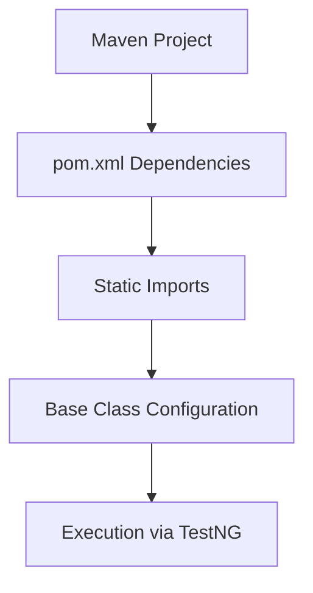

## RestAssured - Project Setup & Dependencies

### 1. ⚡ Flashcard Summary (30-Second Review)

- **Status:** A Java DSL for testing RESTful web services.
- **Why it matters:** Provides Gherkin-style `given/when/then` readability to technical API tests.
- **Key Keywords:** DSL, Hamcrest Matchers, Static Imports, GPath, Serializer/Deserializer.

### 2. 🏛️ Architectural Context (The "Why")

- **Layered Automation:** RestAssured acts as the "Communication Layer" between your Java test code and the HTTP server.
- **Problem vs. Solution:**
    - *Problem:* Native Java `HttpURLConnection` is verbose and requires manual parsing of JSON/Response codes.
    - *Solution:* RestAssured abstracts the boilerplate, providing built-in Assertion and Mapping capabilities.

### 3. 🛠️ Implementation & Mermaid Workflow (The "How")

**Automation Project Bootstrap:**



**Essential Maven Dependencies:**

```xml
<!-- REST Assured Core -->
<dependency>
    <groupId>io.restassured</groupId>
    <artifactId>rest-assured</artifactId>
    <version>5.4.0</version>
    <scope>test</scope>
</dependency>

<!-- JSON Schema Validator: Vital for Contract Testing. 
     Ensures Response body structure matches the API spec. -->
<dependency>
    <groupId>io.restassured</groupId>
    <artifactId>json-schema-validator</artifactId>
    <version>5.4.0</version>
</dependency>

<!-- Jackson: The Serialization Engine. 
     Converts Java POJOs to JSON and vice-versa. -->
<dependency>
    <groupId>com.fasterxml.jackson.core</groupId>
    <artifactId>jackson-databind</artifactId>
    <version>2.17.0</version>
</dependency>

<!-- Project Lombok: Reduces Boilerplate. 
     Automatically generates getters/setters/builders for POJOs. -->
<dependency>
    <groupId>org.projectlombok</groupId>
    <artifactId>lombok</artifactId>
    <version>1.18.32</version>
    <scope>provided</scope>
</dependency>

<!-- Owner: Type-safe Property Management. 
     Loads config.properties into Java Interfaces (Industry Standard). -->
<dependency>
    <groupId>org.aeonbits.owner</groupId>
    <artifactId>owner</artifactId>
    <version>1.0.12</version>
</dependency>

<!-- Java Faker: Dynamic Test Data. 
     Generates random names, addresses, and emails for payloads. -->
<dependency>
    <groupId>com.github.javafaker</groupId>
    <artifactId>javafaker</artifactId>
    <version>1.0.2</version>
</dependency>

<!-- TestNG: The Execution Engine. 
     Handles test ordering, grouping, and parallel execution. -->
<dependency>
    <groupId>org.testng</groupId>
    <artifactId>testng</artifactId>
    <version>7.10.1</version>
    <scope>test</scope>
</dependency>
```

### 4. ⚖️ The Comparison Matrix (RestAssured vs. HttpClient)

| Feature | RestAssured | Java HttpClient |
| :--- | :--- | :--- |
| **Syntax** | Fluent DSL (given/when/then) | Procedural / Request-Response |
| **JSON Support** | Native (GPath) | Requires external libraries (Jackson) |
| **Assertions** | Built-in (Hamcrest) | Manual (JUnit/TestNG Assert) |
| **Learning Curve** | Low (SDET Friendly) | High (Developer Oriented) |

### 5. 🎤 The "Senior Ace" Q&A

- **Q:** *"Why do we need Jackson or Gson if RestAssured already handles JSON?"*
- **A:** "RestAssured provides the *GPath* syntax for simple extraction, but for complex Object Mapping (Serialization), it needs an external engine like Jackson. Without these, you cannot use `.as(MyClass.class)` to convert JSON into a POJO, which is the industry standard for maintaining a clean, scalable test framework."

### 6. ⚠️ The Gotcha (Production Battle Scars)

- **Dependency Conflicts (Groovy):** RestAssured is built on Groovy. If your project has another Groovy dependency (like Spock), you will face `NoSuchMethodError`.
- **The Hamcrest Trap:** `hamcrest-all` is deprecated. Always use the modern `hamcrest` dependency (2.x) to avoid library bloating.
- **Static Import Confusion:** Beginners forget `import static io.restassured.RestAssured.*;`. This results in repetitive `RestAssured.given()` calls that clutter the code.
