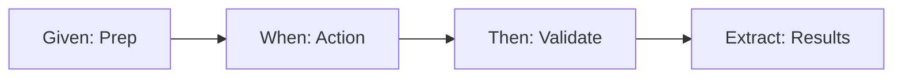

## RestAssured DSL - given(), when(), then()

### 1. ⚡ Flashcard Summary (30-Second Review)

- **Status:** The BDD-style structure for writing expressive API tests.
- **Why it matters:** Clearly separates Pre-requisites, Actions, and Assertions.
- **Key Keywords:** RequestSpecification, ResponseSpecification, Matchers, Extraction.

### 2. 🏛️ Architectural Context (The "Why")

- **Behavioral Alignment:** By mirroring Gherkin, these tests can be understood by developers, QA, and even product owners.
- **Stateless Verification:** Each block ensures that the Request is built without cross-contaminating other tests.
- **Problem vs. Solution:**
    - *Problem:* Complex headers and authentication lead to redundant "Spaghetti Code."
    - *Solution:* `RequestSpecification` allows you to pre-define the "Given" block and reuse it across multiple tests.

### 3. 🛠️ Implementation & Mermaid Workflow (The "How")

**The DSL Execution Lifecycle:**



**Clean Production Syntax:**

```java
// Reusable Spec
RequestSpecification spec = new RequestSpecBuilder()
    .setBaseUri("https://api.myapp.com")
    .setContentType(ContentType.JSON)
    .build();

given()
    .spec(spec)
    .body(payload)
.when()
    .post("/v1/create")
.then()
    .statusCode(201)
    .body("id", notNullValue());
```

### 4. ⚖️ The Comparison Matrix (given() vs. RequestSpec)

| Feature | given()... | RequestSpecification |
| :--- | :--- | :--- |
| **Scope** | Local to a single test | Reusable across multiple classes |
| **Maintenance** | High (Updates needed per test) | Low (Centralized update) |
| **Readability** | Good for short tests | Best for complex enterprise suites |
| **Flexibility** | Ad-hoc overrides | Structured Base-URI/Auth |

### 5. 🎤 The "Senior Ace" Q&A

- **Q:** *"Can we run a test without given()? And what is the benefit of including it?"*
- **A:** "Technically, you can start with `when().get()`. However, `given()` is the 'entry point' for the RestAssured DSL. It provides the placeholder for headers, params, and auth. Including it even when empty maintains the **BDD (Behavior Driven Development)** structure, which is essential for team consistency and readability in larger frameworks."

### 6. ⚠️ The Gotcha (Production Battle Scars)

- **The "Return Type" Trap:** Calling `.then()` returns a `ValidatableResponse`. If you need to use the ID of a created user in the next test, you MUST call `.extract().jsonPath()`—you cannot call `.then().get("id")`.
- **Spec Leakage:** Using global static `RestAssured.baseURI` can cause issues during **Parallel Execution**. 
    - *Senior Solution:* Always pass an explicit `RequestSpecification` instance to `given().spec(mySpec)` to ensure thread isolation.
- **Extracting vs Validating:** Beginners often perform assertions inside `.then()`, but if they need data for a DB check, they fail to extract it properly. 
    - *Senior Tip:* Separate the "Validation API" (`then().body()`) from the "Extraction API" (`extract().as()`).
