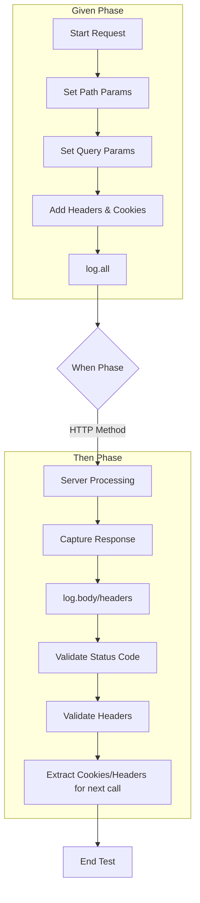

# 05: Parameters, Headers, Cookies, and Logging

### 1. 🚀 Tutorial Overview
In enterprise API automation, static requests are rare. Real-world scenarios require dynamic URL construction, stateful session management, and granular metadata validation. This tutorial deep-dives into the mechanisms RestAssured provides for manipulating request components (Parameters, Headers, Cookies) and the observability tools (Logging) essential for debugging complex interaction flows.

- **Purpose:** To master dynamic request construction and comprehensive response validation.
- **Context:** Occurs during the `Given` (request setup) and `Then` (validation/extraction) phases of the RestAssured DSL.
- **Prerequisites:** Understanding of HTTP basics and the RestAssured `Given/When/Then` structure.

---

### 2. 📌 Core Theoretical Pillars

#### A. Dynamic URL Construction
- **Path Parameters:** Used to identify a specific resource (e.g., `/users/{id}`). They are part of the URL path itself.
- **Query Parameters:** Used to filter or sort resources (e.g., `/users?role=admin`). They appear after the `?` in the URL.

#### B. Metadata vs. State
- **Headers:** Key-value pairs representing metadata about the request/response (Content-Type, Authorization, Custom Tracking IDs).
- **Cookies:** A specific type of header used for state management, allowing the server to recognize a "session" across multiple stateless HTTP requests.

#### C. Observability (Logging)
Logging is the process of recording the details of the HTTP exchange. In automation, it serves as the primary diagnostic tool when assertions fail in remote environments (CI/CD).

---

### 3. 🛠️ Step-by-Step Chronological Implementation

#### Phase 1: Dynamic Value Injection (Parameters)
RestAssured allows for clean separation of the base path and dynamic variables.

```java
// Path Parameters
given()
    .pathParam("userId", 123)
    .pathParam("post", "comments")
.when()
    .get("https://api.example.com/users/{userId}/{post}") // Variables replaced at runtime
.then()
    .statusCode(200);

// Query Parameters
given()
    .queryParam("page", 1)
    .queryParam("sort", "desc")
.when()
    .get("https://api.example.com/products") // Becomes .../products?page=1&sort=desc
.then()
    .statusCode(200);
```

#### Phase 2: Headers & Cookies (Metadata & State)
Capturing a cookie from one response and passing it to the next is a standard pattern for session-based APIs.

```java
// 1. Capture Cookie and Headers
Response loginResponse = 
    given()
        .formParam("username", "admin")
        .formParam("password", "pass123")
    .when()
        .post("/login");

String sessionId = loginResponse.getCookie("JSESSIONID");
String serverHeader = loginResponse.getHeader("Server");

// 2. Use Captured State in next request
given()
    .cookie("JSESSIONID", sessionId)
    .header("X-Request-Source", "Automation")
.when()
    .get("/dashboard")
.then()
    .statusCode(200)
    .header("Content-Type", "application/json"); // Validating specific header
```

#### Phase 3: Observability (Logging)
Logging should be used strategically to avoid "log bloating."

```java
given()
    .log().all() // Log entire request: Headers, Body, Params
    .queryParam("type", "premium")
.when()
    .get("/users")
.then()
    .log().body() // Log only the response body
    .log().headers() // Log only response headers
    .statusCode(200);
```

---

### 4. 📊 Technical Component Encyclopedia

| Method | Source | Method Signature | Definition & Example |
| :--- | :--- | :--- | :--- |
| `.pathParam()` | `io.restassured.specification.RequestSpecification` | `pathParam(String name, Object value)` | Defines a named path variable. <br> `pathParam("id", 10)` |
| `.queryParam()` | `io.restassured.specification.RequestSpecification` | `queryParam(String name, Object value)` | Appends a query parameter to the URL. <br> `queryParam("q", "search")` |
| `.header()` | `io.restassured.specification.RequestSpecification` | `header(String name, Object value)` | Sets a single request header. <br> `header("Auth", "Token")` |
| `.cookie()` | `io.restassured.specification.RequestSpecification` | `cookie(String name, Object value)` | Sets a single request cookie. <br> `cookie("key", "val")` |
| `.getHeaders()` | `io.restassured.response.Response` | `getHeaders()` | Returns all headers from the response. <br> `response.getHeaders()` |
| `.getCookies()` | `io.restassured.response.Response` | `getCookies()` | Returns all cookies as a `Map<String, String>`. <br> `response.getCookies()` |
| `.log().all()` | `io.restassured.specification.LogConfig` | `all()` | Logs everything (Request or Response). <br> `.log().all()` |
| `.log().body()` | `io.restassured.specification.LogConfig` | `body()` | Logs only the body. <br> `.log().body()` |
| `.log().headers()` | `io.restassured.specification.LogConfig` | `headers()` | Logs only the headers. <br> `.log().headers()` |
| `.log().ifValidationFails()` | `io.restassured.specification.LogConfig` | `ifValidationFails()` | **Industrial Standard:** Logs only if an assertion fails. |

---

### 5. 🔄 Visual Workflow (Mermaid)



---

### 6. 🏭 Real-World Industrial Patterns

#### A. Centralized Request Specification
In professional frameworks, common headers and logging configurations are abstracted into a utility class or base test.

```java
public class BaseTest {
    protected static RequestSpecification requestSpec;

    @BeforeClass
    public static void setup() {
        requestSpec = new RequestSpecBuilder()
            .setBaseUri("https://api.myapp.com")
            .addHeader("Authorization", "Bearer " + fetchToken())
            .addHeader("Content-Type", "application/json")
            .addFilter(new ResponseLoggingFilter()) // Global logging
            .addFilter(new RequestLoggingFilter())
            .build();
    }
}

// In Test Class
public class UserTests extends BaseTest {
    @Test
    public void testUserDetails() {
        given()
            .spec(requestSpec)
            .pathParam("id", 1)
        .when()
            .get("/users/{id}")
        .then()
            .statusCode(200);
    }
}
```

#### B. Dynamic Cookie Chaining
Handling authentication flow by passing cookies between requests without hardcoding.

```java
Map<String, String> sessionCookies = 
    given()
        .log().all()
        .body(credentials)
    .when()
        .post("/auth/login")
    .then()
        .statusCode(200)
        .extract().cookies(); // Extract all cookies at once

// Subsequent request using all extracted cookies
given()
    .cookies(sessionCookies)
.when()
    .get("/account/balance")
.then()
    .log().ifValidationFails()
    .statusCode(200);
```
