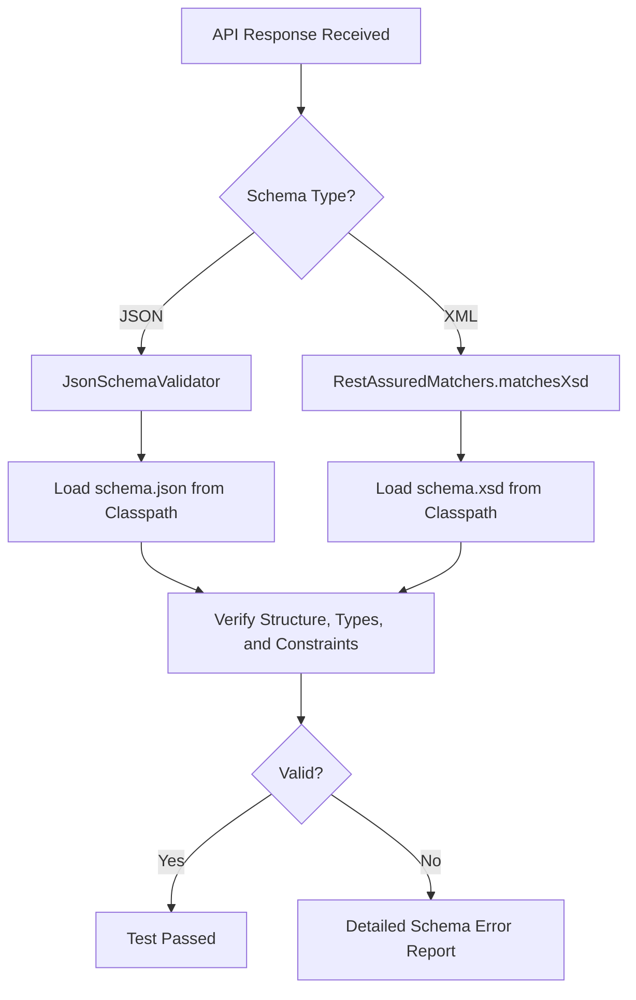

# 08: Schema Validation (JSON and XML)

### 1. 🚀 Tutorial Overview
While field-level validation ensures specific values are correct, **Schema Validation** ensures the structural integrity of the entire response. It acts as a contract test, verifying that the API follows the agreed-upon data types, required fields, and format (RegEx, ranges, etc.) without having to assert every field individually.

- **Purpose:** To perform structural "Contract Testing" and ensure schema stability.
- **Context:** Occurs in the `Then` phase using specialized matchers.
- **Prerequisites:** A valid JSON Schema (`.json`) or XML Schema Document (`.xsd`) stored in the project classpath.

---

### 2. 📌 Core Theoretical Pillars

#### A. Response Validation vs. Schema Validation
- **Response Validation:** Checks if `user.id == 101`. (Value focus)
- **Schema Validation:** Checks if `user.id` is an `integer`, if `user.name` is a `string`, and if both are `required`. (Structure focus)

#### B. The JSON Schema Standard
JSON Schema is a vocabulary that allows you to annotate and validate JSON documents. It can define:
- **Types:** string, number, object, array, boolean, null.
- **Constraints:** `minLength`, `maximum`, `pattern` (Regex).
- **Relationships:** `required` fields, `additionalProperties` (strictness).

#### C. XSD (XML Schema Definition)
XSD is the XML equivalent. It defines the structure, content, and semantics of XML documents, including complex types and namespaces common in SOAP services.

---

### 3. 🛠️ Step-by-Step Chronological Implementation

#### Phase 1: Generating the Schema
Before validating, you need a schema file.
1. **JSON:** Use online tools or plugins to convert a sample response to a JSON Schema. Save as `src/test/resources/schema.json`.
2. **XML:** Generate an XSD from a sample XML response. Save as `src/test/resources/schema.xsd`.

#### Phase 2: JSON Schema Validation
Using the `JsonSchemaValidator` library (requires `json-schema-validator` dependency).

```java
import static io.restassured.module.jsonschema.JsonSchemaValidator.matchesJsonSchemaInClasspath;

given()
.when()
    .get("/products/1")
.then()
    .assertThat()
    .body(matchesJsonSchemaInClasspath("product-schema.json"));
```

#### Phase 3: XML Schema Validation (XSD)
Validating older SOAP-style or XML-based responses.

```java
import static io.restassured.matcher.RestAssuredMatchers.matchesXsdInClasspath;

given()
.when()
    .get("/soap/user/10")
.then()
    .assertThat()
    .body(matchesXsdInClasspath("user-schema.xsd"));
```

---

### 4. 📊 Technical Component Encyclopedia

| Component | Library | Method Signature | Definition & Example |
| :--- | :--- | :--- | :--- |
| `matchesJsonSchemaInClasspath` | `io.restassured.module.jsonschema` | `matchesJsonSchemaInClasspath(String path)` | Validates response body against a JSON schema file in resources. |
| `matchesXsdInClasspath` | `io.restassured.matcher` | `matchesXsdInClasspath(String path)` | Validates response body against an XSD file in resources. |
| `matchesJsonSchema` | `io.restassured.module.jsonschema` | `matchesJsonSchema(String schema)` | Validates against a schema provided as a String. |
| `JsonSchemaValidatorSettings` | `io.restassured.module.jsonschema` | `settings()` | Configuration for strictness or using specific schema versions (Draft v4, etc). |

---

### 5. 🔄 Visual Workflow (Mermaid)



---

### 6. 🏭 Real-World Industrial Patterns

#### A. Strict Structural Validation
In production-grade frameworks, we often disable `additionalProperties` in the schema to ensure the API doesn't leak unexpected data.

```java
// Logic: Schema validation with global settings for strictness
JsonSchemaValidator.settings = settings().with().checkedValidation(true);

given()
.when()
    .get("/secure-data")
.then()
    .body(matchesJsonSchemaInClasspath("strict-schema.json"));
```

#### B. Dynamic Schema Selection
Utility to select a schema based on the environment or API version.

```java
public void validateSchema(Response response, String schemaName) {
    response.then().assertThat().body(matchesJsonSchemaInClasspath("schemas/" + schemaName + ".json"));
}
```

---

### 🛡️ Content Preservation Note
- Schema validation does NOT replace value validation; it complements it. Always check critical business values (e.g., prices, IDs) alongside the schema.
- Ensure the `json-schema-validator` dependency is added to your `pom.xml`, as it is not included in the core RestAssured artifact.
