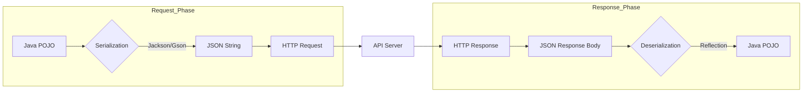

# 09: Serialization and Deserialization Internals

### 1. 🚀 Tutorial Overview
At its core, API automation is a translation task. Your Java code speaks in "Objects," but the network speaks in "JSON/XML." This tutorial deep-dives into the transformation engine of RestAssured: **Serialization** (Java to JSON) and **Deserialization** (JSON to Java), with a focus on the **Jackson ObjectMapper**—the industry-standard library that makes this possible.

- **Purpose:** To understand the underlying transformation logic and handle complex data mappings manually when needed.
- **Context:** Serialization occurs before the request is sent; Deserialization occurs after the response is received.
- **Prerequisites:** Understanding of POJOs (Plain Old Java Objects) and Maven dependency management.

---

### 2. 📌 Core Theoretical Pillars

#### A. The Bridge Pattern (Ser/De)
- **Serialization:** Converting a POJO instance into a JSON string.
- **Deserialization:** Converting a JSON response string back into a POJO instance.

#### B. Reflection and Mapping
The **Jackson Library** uses Java Reflection to inspect your POJO classes, find fields, and map them to JSON keys. It looks for matching names or specific annotations like `@JsonProperty`.

#### C. Content-Type Negotiation
RestAssured doesn't just guess. It uses the `Content-Type` and `Accept` headers to decide which serializer to use. If you set `ContentType.JSON`, RestAssured automatically searches the classpath for Jackson/Gson to handle the conversion.

---

### 3. 🛠️ Step-by-Step Chronological Implementation

#### Phase 1: Manual Serialization (The ObjectMapper Approach)
Understanding how to manually convert an object to a string using Jackson's `ObjectMapper`. This is essential for debugging or advanced logging.

```java
import com.fasterxml.jackson.databind.ObjectMapper;

// 1. Create a POJO
User user = new User("Sagar", "SDET");

// 2. Use ObjectMapper to serialize
ObjectMapper mapper = new ObjectMapper();
String jsonPayload = mapper.writerWithDefaultPrettyPrinter().writeValueAsString(user);

System.out.println("Generated JSON: " + jsonPayload);

// 3. Pass the string to RestAssured
given().body(jsonPayload).post("/users");
```

#### Phase 2: Manual Deserialization (JSON to POJO)
Converting a raw response string into a Java object for easier assertion logic.

```java
Response response = get("/users/1");
String body = response.asString();

// Logic: Manually mapping string to Object
User userObj = mapper.readValue(body, User.class);
Assert.assertEquals(userObj.getName(), "Sagar");
```

#### Phase 3: Automatic Implementation (The RestAssured Way)
RestAssured handles the above steps implicitly if the headers are correct. This is the production-standard approach.

> [!TIP]
> **Zero-Import Coding:** In this phase, you do NOT need to import `ObjectMapper` or any Jackson classes into your Java file. RestAssured uses reflection to "detect and use" Jackson automatically. However, the Jackson library **must** still be present in your `pom.xml` dependencies.

```java
// Logic: RestAssured calls ObjectMapper internally
User user = new User("Sagar", "SDET");

User responseUser = 
    given()
        .contentType(ContentType.JSON) // Mandatory for auto-serialization
        .body(user)
    .when()
        .post("/users")
    .then()
        .extract()
        .as(User.class); // Auto-deserialization
```

---

### 4. 📊 Technical Component Encyclopedia

| Component | Library | Method/Class | Responsibility |
| :--- | :--- | :--- | :--- |
| `ObjectMapper` | `com.fasterxml.jackson` | `writeValueAsString()` | Converts Java Object -> JSON String. |
| `ObjectMapper` | `com.fasterxml.jackson` | `readValue()` | Converts JSON String -> Java Object. |
| `.as(Class)` | `io.restassured` | `as(Target.class)` | RestAssured's shortcut for implicit deserialization. |
| `@JsonProperty` | `com.fasterxml.jackson` | Annotation | Maps a Java field name to a different JSON key name. |
| `@JsonIgnore` | `com.fasterxml.jackson` | Annotation | Prevents a field from being serialized/deserialized. |

---

### 5. 🔄 Visual Workflow (Mermaid)



---

### 6. 🏭 Real-World Industrial Patterns

#### A. Internal Mechanism Awareness
RestAssured identifies serializers in this priority:
1. **Jackson 2** (preferred)
2. **Jackson**
3. **Gson**

**Best Practice:** Always include `jackson-databind` in your `pom.xml` to avoid "Could not find a serializer" errors.

#### B. The "Header Rule"
Automatic serialization ONLY works if you specify the `ContentType`. Without it, RestAssured treats the body as a raw string or byte stream.

```java
// Senior Tip: Always use constants
given()
    .contentType(ContentType.JSON)
    .body(myObject)
```

#### C. Handling Snake Case vs Camel Case
In many APIs, JSON uses `snake_case` while Java uses `camelCase`.

```java
public class User {
    @JsonProperty("first_name") // Maps "first_name" in JSON to firstName in Java
    private String firstName;
}
```

---

### 🛡️ Content Preservation Note
- This tutorial provides the "Engine Details" for the strategies introduced in **04: Test Data Handling**.
- Manual use of `ObjectMapper` is rare in tests but common in **Utility Classes** or **Custom Loggers**.
