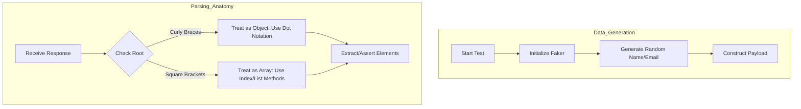

# 11: JSON Anatomy and Data Generation (Faker)

### 1. 🚀 Tutorial Overview
Mastering API automation requires a surgical understanding of the data structures being exchanged. This tutorial covers the **Anatomy of JSON** (Objects, Arrays, and Elements) and introduces the **Faker Library**—the industry-standard tool for generating dynamic, realistic test data to eliminate hardcoded values and improve test coverage.

- **Purpose:** To understand JSON hierarchies and automate dynamic data generation.
- **Context:** Occurs during payload construction (Faker) and response analysis (JSON Anatomy).
- **Prerequisites:** Basic understanding of Key-Value pairs and Maven dependency management.

---

### 2. 📌 Core Theoretical Pillars

#### A. JSON Anatomy: The Building Blocks
- **JSON Object (`{}`):** A collection of key-value pairs. Think of it as a Java `Map` or a single record.
- **JSON Array (`[]`):** An ordered list of values or objects. Think of it as a Java `List`.
- **JSON Element:** The smallest unit—can be a string, number, boolean, null, object, or array.

#### B. Dynamic Data Generation (The "Faker" Philosophy)
Using hardcoded data like `"TestUser123"` leads to fragile tests and database collisions. The **Faker Library** generates localized, randomized data (names, addresses, business info) that mimics real-world usage.

---

### 3. 🛠️ Step-by-Step Chronological Implementation

#### Phase 1: Generating Random Data with Faker
Adding the `javafaker` dependency and generating various data types.

```java
import com.github.javafaker.Faker;

Faker faker = new Faker();

// 1. Identity Data
String firstName = faker.name().firstName();
String email = faker.internet().safeEmailAddress();

// 2. Business & Finance
String creditCard = faker.business().creditCardNumber();
String currency = faker.business().creditCardType();

// 3. Random Fun Data (Great for unique identifiers)
String animal = faker.animal().name();
String catchPhrase = faker.company().catchPhrase();

// Logic: Using in a payload
Map<String, Object> payload = new HashMap<>();
payload.put("username", firstName + "_" + faker.number().digits(4));
payload.put("bio", catchPhrase);
```

#### Phase 2: Parsing Hierarchies (Object-Start vs Array-Start)
RestAssured handles navigation differently based on the root of the JSON.

**Scenario A: Response starts with an Object `{...}`**
```java
// JSON: { "id": 1, "data": { "key": "val" } }
given().when().get("/obj")
.then()
    .body("id", equalTo(1))
    .body("data.key", equalTo("val"));
```

**Scenario B: Response starts with an Array `[...]`**
```java
// JSON: [ {"id":1}, {"id":2} ]
given().when().get("/array")
.then()
    .body("[0].id", equalTo(1)) // Use index for root array
    .body("id", hasItems(1, 2)); // Collects all IDs from the root
```

#### Phase 3: Handling Nested Hierarchies
Navigating JSON arrays containing objects, which in turn contain other arrays.

```java
/* JSON Structure:
{
  "orders": [
    { "id": 101, "items": ["apple", "banana"] },
    { "id": 102, "items": ["orange"] }
  ]
}
*/
given().when().get("/orders")
.then()
    .body("orders[0].items[1]", equalTo("banana")) // Deep navigation
    .body("orders.items.flatten()", hasItems("apple", "orange")); // Collection manipulation
```

---

### 4. 📊 Technical Component Encyclopedia

| Component | Library | Method Signature | Responsibility |
| :--- | :--- | :--- | :--- |
| `Faker` | `com.github.javafaker` | `new Faker()` | The entry point for all data generation. |
| `faker.name()` | `javafaker` | `firstName()`, `lastName()` | Generates realistic human names. |
| `faker.number()`| `javafaker` | `digits(int n)` | Generates random numeric strings. |
| `[n]` | RestAssured / GPath | `[0], [1]` | Index accessor for JSON Arrays. |
| `.` | RestAssured / GPath | `user.address` | Key accessor for JSON Objects. |
| `size()` | RestAssured / GPath | `size()` | Returns the count of elements in an array. |

---

### 5. 🔄 Visual Workflow (Mermaid)



---

### 6. 🏭 Real-World Industrial Patterns

#### Pattern: The "Unique User" Payload Factory
Creating a utility method that returns a unique payload every time it's called.

```java
public class UserFactory {
    private static Faker faker = new Faker();

    public static Map<String, Object> createUniqueUser() {
        Map<String, Object> user = new HashMap<>();
        user.put("name", faker.name().fullName());
        user.put("email", faker.internet().emailAddress());
        user.put("address", faker.address().fullAddress());
        return user;
    }
}
```

---

### 🛡️ Content Preservation Note
- This note bridges the gap between **04: Test Data Handling** and **06: JSON Parsing**, providing the structural definitions needed for senior-level architectural design.
- Always check the **Locale** of Faker (e.g., `new Faker(new Locale("en-IND"))`) if you need region-specific data like Indian addresses or phone numbers.
