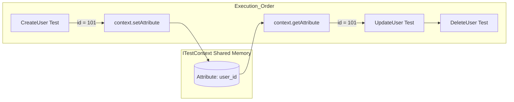

# 12: API Chaining and TestNG Context Integration

### 1. 🚀 Tutorial Overview
In a real-world enterprise framework, tests are rarely isolated. A typical scenario involves creating a resource, performing operations on it, and finally deleting it. **API Chaining** is the technique of capturing dynamic data (like an ID) from one response and passing it as input to subsequent requests. This tutorial focuses on using **TestNG's `ITestContext`** to manage this data flow across multiple test classes.

- **Purpose:** To automate end-to-end business flows and manage state across independent tests.
- **Context:** Orchestrated via `testng.xml` using the `ITestContext` interface.
- **Prerequisites:** Understanding of CRUD operations and basic TestNG XML configuration.

---

### 2. 📌 Core Theoretical Pillars

#### A. The Concept of "State Transfer"
Statelessness is a core principle of REST. However, automation requires "State" to be maintained on the client side. Chaining allows us to bridge this gap by extracting variables (Tokens, IDs) and "injecting" them into the next `given()` block.

#### B. ITestContext (The Shared Warehouse)
TestNG provides `ITestContext`, a powerful interface that acts as a storage bucket for the duration of a test execution. It allows you to:
- **`setAttribute(key, value)`:** Store data at runtime.
- **`getAttribute(key)`:** Retrieve data in a different method or class.

#### C. Scope: Test vs. Suite
- **Test Level Scope:** Data is shared only between classes within the same `<test>` tag in `testng.xml`.
- **Suite Level Scope:** Data is shared across the entire `<suite>`, regardless of which `<test>` tag the class belongs to.

---

### 3. 🛠️ Step-by-Step Chronological Implementation

#### Phase 1: The Create Request (Data Producer)
Extracting the `id` from the response and storing it in the context.

```java
public class CreateUser {
    @Test
    public void testCreateUser(ITestContext context) {
        int id = 
            given()
                .header("Authorization", "Bearer " + token)
                .body(payload)
            .when()
                .post("https://gorest.co.in/public/v2/users")
            .then()
                .extract().path("id");

        // Storing the ID for other classes to use
        context.setAttribute("user_id", id);
    }
}
```

#### Phase 2: The Update/Delete Request (Data Consumer)
Retrieving the `id` from the context and using it in the URL.

```java
public class DeleteUser {
    @Test
    public void testDeleteUser(ITestContext context) {
        // Retrieving the ID from the shared context
        int id = (Integer) context.getAttribute("user_id");

        given()
            .header("Authorization", "Bearer " + token)
            .pathParam("id", id)
        .when()
            .delete("https://gorest.co.in/public/v2/users/{id}")
        .then()
            .statusCode(204);
    }
}
```

#### Phase 3: Orchestration via `testng.xml`
Ensuring the Producer runs before the Consumer.

```xml
<suite name="API Chaining Suite">
    <test name="User Lifecycle">
        <classes>
            <class name="api.tests.CreateUser" />
            <class name="api.tests.UpdateUser" />
            <class name="api.tests.DeleteUser" />
        </classes>
    </test>
</suite>
```

---

### 4. 📊 Technical Component Encyclopedia

| Component | Source/Library | Method | Responsibility |
| :--- | :--- | :--- | :--- |
| `ITestContext` | `org.testng` | Interface | Provides a shared context for test execution. |
| `setAttribute()`| `ITestContext` | `setAttribute(String, Object)` | Stores a value in the context. |
| `getAttribute()`| `ITestContext` | `getAttribute(String)` | Retrieves a value from the context. |
| `context.getSuite()`| `ITestContext` | `getSuite()` | Elevates the scope to the entire Suite level. |
| `testng.xml` | TestNG Config | `<test>`, `<suite>` | Defines the order and scope of test execution. |

---

### 5. 🔄 Visual Workflow (Mermaid)



---

### 6. 🏭 Real-World Industrial Patterns

#### A. Suite-Level Sharing
If tests are divided into different `<test>` tags but need to share data, use the `Suite` context.

```java
// Setting at Suite level
context.getSuite().setAttribute("global_id", id);

// Getting at Suite level
int id = (Integer) context.getSuite().getAttribute("global_id");
```

#### B. Troubleshooting: The "Null" Trap
A common failure occurs when:
1.  **Wrong Scope:** Attempting to get a `test` attribute from a different `<test>` tag.
2.  **Order Failure:** The Consumer runs before the Producer (Verify your `testng.xml` order).
3.  **Type Casting:** `getAttribute` returns `Object`. Always cast it correctly (e.g., `(Integer)`).

---

### 🛡️ Content Preservation Note
- Chaining is essential for **Integration Testing**. For **Unit Testing** of APIs, try to mock dependencies so tests remain truly independent.
- Always implement a **Cleanup** step (Delete) in your chain to ensure your test environment remains clean after execution.
