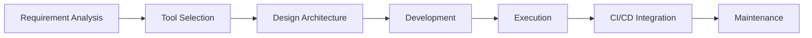

# 00: Framework Fundamentals and SDLC Phases

### 1. 🚀 Tutorial Overview
Building a framework is not just about writing code; it is about establishing a **System** that simplifies testing. This tutorial covers the theoretical foundations of automation frameworks, the "Why" behind their existence, and the standard phases of the Automation Development Life Cycle (ADLC).

- **Purpose:** To understand the objectives of a framework and the systematic approach to building one.
- **Context:** The preliminary phase before touching a single line of code.
- **Prerequisites:** Basic knowledge of Manual Testing and API concepts.

---

### 2. 📌 Core Theoretical Pillars

#### A. Definition and Objectives
An automation framework is a set of guidelines, protocols, and tools used for creating and designing test cases. Its core pillars are:
1.  **Reusability:** Write once, use everywhere (e.g., a single method for 'Create User').
2.  **Maintainability:** Easily update tests when the application changes.
3.  **Readability:** Tests should be understandable by non-technical stakeholders.
4.  **Reduced Scripting Time:** Once the base is ready, adding new tests should be fast.

#### B. Framework Types: The Hybrid Approach
The Petstore project follows a **Hybrid-Driven Framework** model.
- **Modular/Layered:** The framework is divided into logical layers (Endpoints, Payloads, Tests).
- **Data-Driven:** Test data is separated from the scripts (using Excel/JSON/Faker).
- **Keyword/Library Driven:** Common actions are abstracted into utility methods.

---

### 3. 🛠️ Step-by-Step Chronological Implementation

#### Phase 1: Requirement Analysis (The Swagger Audit)
Before coding, we must analyze the API documentation (e.g., Swagger Petstore).
- **Identify Models:** Look for major entities (User, Store, Pet).
- **Map Endpoints:** Identify CRUD paths (`/user`, `/user/{username}`).
- **Define Schema:** Understand mandatory fields, data types, and status codes.

#### Phase 2: Framework Design & Tool Selection
Based on requirements, we select the tech stack:
- **Core:** Java & RestAssured.
- **Test Runner:** TestNG (for assertions and execution control).
- **Data:** Java Faker (Dynamic) & Apache POI (Excel/Static).
- **Reporting:** Extent Reports.
- **Build Tool:** Maven.

#### Phase 3: Development Workflow
1.  **Maven Setup:** Create project and add dependencies to `pom.xml`.
2.  **Architecture:** Create the folder structure (Packages).
3.  **Base Components:** Build Routes, Endpoints, and POJOs.
4.  **Utilities:** Implement Config Readers and Report Listeners.

#### Phase 4: Execution & CI/CD
- Execute via `testng.xml`.
- Integrate with **Git/GitHub** for version control.
- Trigger via **Jenkins** for Continuous Integration.

---

### 4. 📊 Technical Component Encyclopedia

| Phase | Responsibility | Deliverable |
| :--- | :--- | :--- |
| **Analysis** | Studying Swagger/Contract docs. | Test Case Spreadsheet. |
| **Design** | Deciding Layers and Utilities. | High-Level Architecture Diagram. |
| **Development** | Coding Endpoints, Payloads, and Utils. | Framework Source Code. |
| **Execution** | Running Suites and Debugging. | Execution Reports (Extent/Allure). |

---

### 5. 🔄 Visual Workflow (ADLC)



---

### 6. 🏭 Real-World Industrial Patterns

#### A. The "Petstore" Context
In our framework, we prioritize the **User Module** as the starting point.
- **Requirement:** Create a user, verify details, update username, and delete.
- **Design:** `UserEndpoints.java` will house all these interactions.

#### B. Maven Dependency Management
A senior framework ensures that dependencies are minimal and updated.

```xml
<!-- Core Dependencies -->
<dependency>
    <groupId>io.rest-assured</groupId>
    <artifactId>rest-assured</artifactId>
    <version>5.3.0</version>
</dependency>
<dependency>
    <groupId>org.testng</groupId>
    <artifactId>testng</artifactId>
    <version>7.7.1</version>
</dependency>
```

---

### 🛡️ Content Preservation Note
- This theory provides the context for **01: Layered Architecture**.
- Always perform a thorough "Manual Run" in Postman or Swagger before automating to ensure the endpoints are active and healthy.
