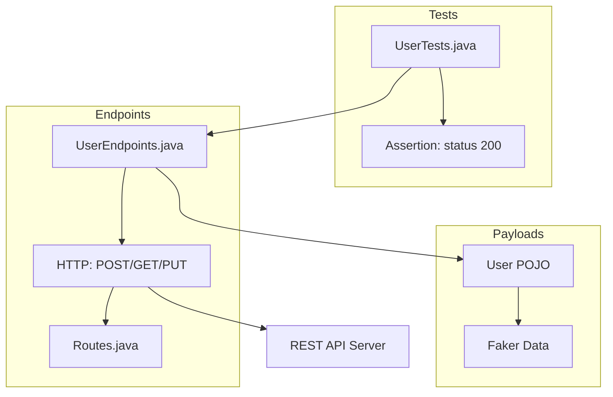

# 01: Layered Architecture and Folder Structure

### 1. 🚀 Tutorial Overview
Transitioning from writing simple API scripts to building a **Senior-level Automation Framework** requires a fundamental shift in mindset. You are no longer just a "Scripter"; you are an "Architect." This tutorial covers the **Layered Architecture** pattern—the industry-standard approach for building scalable, maintainable, and readable RestAssured frameworks.

- **Purpose:** To implement "Separation of Concerns" (SoC) and ensure that changes in API endpoints or logic don't break dozens of tests.
- **Context:** Based on the **Swagger Petstore API** requirements (User, Pet, and Store modules).
- **Prerequisites:** Completion of the core RestAssured tutorials (Sessions 01-12).

---

### 2. 📌 Core Theoretical Pillars

#### A. Separation of Concerns (SoC)
In a poorly designed framework, the test method handles everything: URLs, Headers, Body construction, and Validation. In a **Layered Architecture**, we divide these responsibilities:
- **Test Layer:** Only contains business logic and assertions.
- **Service Layer (Endpoints):** Only contains the HTTP logic (Methods, URLs).
- **Data Layer (Payloads):** Only contains the JSON/POJO construction.

#### B. Maintenance and Scalability
By abstracting URLs and HTTP methods into a separate "Endpoints" layer, you achieve **Single Point of Maintenance**. If an endpoint URL changes from `/v1/users` to `/v2/users`, you update it in one class, and all 500 tests using it are instantly fixed.

#### C. Maven-Driven Dependency Management
A professional project manages its lifecycle via Maven. The `pom.xml` must include:
- `rest-assured`: The core DSL.
- `testng`: The execution engine.
- `jackson-databind`: For POJO serialization.
- `json-path`: For response navigation.
- `javafaker`: For dynamic data.
- `extentreports`: For visual results.

---

### 3. 🛠️ Step-by-Step Chronological Implementation

#### Phase 1: The Blueprint (Folder Structure)
A professional SDET project follows a strict package hierarchy within `src/test/java`.

```text
com.project.api
├── base          # Global configurations (BaseTest.java)
├── endpoints     # HTTP Method abstractions (UserEndpoints.java)
├── payloads      # POJOs and Data Factories
├── utils         # Helper classes (ConfigReader, PropertyUtils)
└── tests         # The actual TestNG/JUnit test classes
```

#### Phase 2: The Endpoints Layer (Abstraction)
Instead of calling `given().when().post(...)` in the test, we create a specialized class.

```java
// api.endpoints.UserEndpoints.java
public class UserEndpoints {
    public static Response createUser(User payload) {
        return given()
                .contentType(ContentType.JSON)
                .accept(ContentType.JSON)
                .body(payload)
            .when()
                .post(Routes.post_url);
    }
    
    public static Response getUser(String userName) {
        return given()
                .pathParam("username", userName)
            .when()
                .get(Routes.get_url);
    }
}
```

#### Phase 3: The Routes Layer
Centralizing all URLs into a single interface or class.

```java
// api.endpoints.Routes.java
public class Routes {
    public static String base_url = "https://petstore.swagger.io/v2";
    
    // User Module
    public static String post_url = base_url + "/user";
    public static String get_url = base_url + "/user/{username}";
}
```

---

### 4. 📊 Technical Component Encyclopedia

| Layer | Package Name | Responsibility | Key Classes |
| :--- | :--- | :--- | :--- |
| **Routes** | `api.endpoints` | Houses all static URL strings. | `Routes.java` |
| **Endpoints** | `api.endpoints` | Implementation of CRUD logic. | `UserEndpoints.java` |
| **Payloads** | `api.payloads` | POJO classes and Data Generation. | `User.java`, `UserFactory.java` |
| **Tests** | `api.tests` | Business logic and Assertions. | `UserTests.java` |
| **Base** | `api.base` | Common setup/teardown. | `BaseTest.java` |
| **Utils** | `api.utils` | Property files, Loggers, Reports. | `ConfigReader.java` |

---

### 5. 🔄 Visual Workflow (Mermaid)



---

### 6. 🏭 Real-World Industrial Patterns

#### A. The "Petstore" Routes Implementation
Centralizing all URLs into a single interface or class to avoid hardcoding in test methods.

```java
// api.endpoints.Routes.java
public class Routes {
    public static String base_url = "https://petstore.swagger.io/v2";
    
    // User Module Endpoints
    public static String post_url = base_url + "/user";
    public static String get_url = base_url + "/user/{username}";
    public static String update_url = base_url + "/user/{username}";
    public static String delete_url = base_url + "/user/{username}";
}
```

#### B. The "Clean Test" Pattern
In a senior-level framework, the test class should look like a story, free of technical clutter.

```java
public class UserTests {
    @Test
    public void testPostUser() {
        // Arrange
        User userPayload = UserFactory.getNewUser();
        
        // Act
        Response response = UserEndpoints.createUser(userPayload);
        
        // Assert
        response.then().log().all();
        Assert.assertEquals(response.getStatusCode(), 200);
    }
}
```

#### B. Singleton Config Management
Using a utility to load properties once and reuse them across the framework.

```java
public class ConfigReader {
    private static Properties properties;
    
    static {
        // Logic: Load properties from file only once
        try (FileInputStream fis = new FileInputStream("config.properties")) {
            properties = new Properties();
            properties.load(fis);
        } catch (IOException e) {
            e.printStackTrace();
        }
    }
    
    public static String getProperty(String key) {
        return properties.getProperty(key);
    }
}
```

---

### 🛡️ Content Preservation Note
- This architecture serves as the foundation for the upcoming **GoRest API Project** walkthrough.
- While this example uses static methods for simplicity, enterprise frameworks often use **Dependency Injection (Guice/Spring)** to manage these layers.
