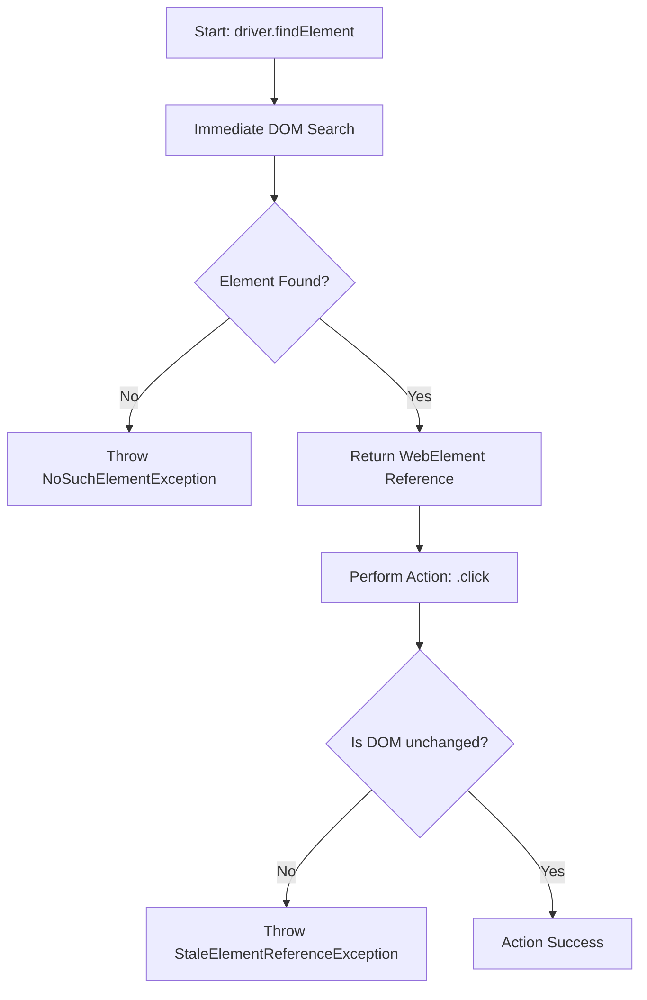

# Selenium Locators: Implementation & Resilience

## 🚀 Tutorial Overview
In Selenium Java, locators are defined using the `By` class. Unlike Playwright's lazy locators, Selenium's `findElement()` immediately attempts to locate the element in the DOM and returns a `WebElement` object. This immediate execution model requires explicit synchronization (Waits) to handle dynamic web content.

This tutorial covers the technical implementation of locator strategies in Selenium, focusing on industrial patterns for stabilizing legacy and modern web applications.

### Context within the Automation Lifecycle
- **Modernization:** Transitioning from fragile CSS/XPath to robust identifier strategies.
- **Legacy Support:** Handling monolithic applications with deep nesting and dynamic IDs.

---

## 📌 Core Theoretical Pillars

### 1. The `By` Class
The `By` class is the entry point for all locator strategies in Selenium. It creates a "locator strategy object" which is then passed to the driver.

### 2. The `WebElement` Lifecycle
A `WebElement` is a reference to an element in the browser's current DOM state. If the page refreshes or the element is detached, the reference becomes "Stale", leading to the infamous `StaleElementReferenceException`.

---

## 🛠️ Step-by-Step Chronological Implementation

### Phase 1: Basic Locator Implementation
The standard way to find elements using the `WebDriver` instance.

```java
// Locating by ID (Standard)
WebElement loginBtn = driver.findElement(By.id("login-button"));

// Locating by Name
WebElement username = driver.findElement(By.name("user-name"));

// Locating by Link Text
WebElement logoutLink = driver.findElement(By.linkText("Logout"));
```

### Phase 2: Advanced CSS & XPath in Java
Using the powerful strategies defined in the common theory notes.

```java
// CSS Selector: Attribute contains
WebElement searchBox = driver.findElement(By.cssSelector("input[placeholder*='Search']"));

// XPath: Text match with Following Sibling
WebElement submitBtn = driver.findElement(By.xpath("//label[text()='Submit']/following-sibling::button"));
```

### Phase 3: Handling Multiple Elements
Finding a list of elements for validation or iteration.

```java
// Finding all links on a page
List<WebElement> links = driver.findElements(By.tagName("a"));
System.out.println("Total links: " + links.size());

// Filtering elements via Stream API (Java 8+)
WebElement specificLink = links.stream()
    .filter(e -> e.getText().contains("Contact Us"))
    .findFirst()
    .orElseThrow();
```

---

## 📊 Technical Component Encyclopedia

| Method | Source | Return Type | Description |
| :--- | :--- | :--- | :--- |
| `By.id(String)` | `org.openqa.selenium.By` | `By` | Locates by `id` attribute. |
| `By.name(String)` | `org.openqa.selenium.By` | `By` | Locates by `name` attribute. |
| `By.className(String)` | `org.openqa.selenium.By` | `By` | Locates by `class` attribute. |
| `By.cssSelector(String)` | `org.openqa.selenium.By` | `By` | Locates using CSS syntax. |
| `By.xpath(String)` | `org.openqa.selenium.By` | `By` | Locates using XPath syntax. |
| `By.linkText(String)` | `org.openqa.selenium.By` | `By` | Exact match for `<a>` text. |
| `By.partialLinkText(String)`| `org.openqa.selenium.By` | `By` | Partial match for `<a>` text. |
| `driver.findElement(By)` | `org.openqa.selenium.WebDriver` | `WebElement` | Finds first matching element. |
| `driver.findElements(By)` | `org.openqa.selenium.WebDriver` | `List<WebElement>`| Finds all matching elements. |

---

## 🔄 Visual Workflow (Mermaid)



---

## 🏭 Real-World Industrial Patterns

### 1. PageFactory (@FindBy) Pattern
In enterprise frameworks, locators are often decoupled from logic using the `PageFactory`.

```java
public class LoginPage {
    
    @FindBy(id = "user-name")
    private WebElement usernameInput;

    @FindBy(css = ".submit-button")
    private WebElement submitBtn;

    public LoginPage(WebDriver driver) {
        PageFactory.initElements(driver, this);
    }

    public void login(String user) {
        usernameInput.sendKeys(user);
        submitBtn.click();
    }
}
```

### 2. Custom Wrapper for Resilience
To avoid flakiness, Senior Architects often wrap Selenium calls with Explicit Waits.

```java
public class ElementUtils {
    private WebDriver driver;
    private WebDriverWait wait;

    public ElementUtils(WebDriver driver) {
        this.driver = driver;
        this.wait = new WebDriverWait(driver, Duration.ofSeconds(10));
    }

    public void clickWhenReady(By locator) {
        wait.until(ExpectedConditions.elementToBeClickable(locator)).click();
    }
}
```

---
