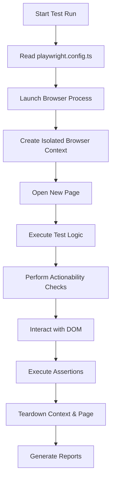

# Playwright Foundations & Environment Setup

## 🚀 Tutorial Overview
Playwright is a modern, cross-browser automation framework designed for the specialized needs of web testing and scraping. Developed by Microsoft, it addresses the limitations of legacy tools like Selenium by providing built-in auto-waiting, network interception, and a unique architecture that treats the browser as a managed process rather than a remote service.

This tutorial focuses on setting up a **TypeScript-based Playwright architecture**, which is the industrial gold standard due to its strong typing, superior IDE support, and native integration with the Playwright Test Runner.

### Context within the Automation Lifecycle
Environment setup is the "Phase 0" of the SDLC. A correctly configured Playwright environment ensures:
- **Flake-free execution** through proper browser context management.
- **Developer productivity** via the Trace Viewer and VS Code Extension.
- **CI/CD readiness** with standardized config files and reporters.

### Prerequisites
- **Node.js (LTS):** Version 18 or higher.
- **Package Manager:** npm or yarn.
- **IDE:** VS Code (highly recommended for the official Playwright extension).

---

## 📌 Core Theoretical Pillars

### 1. The Architecture: CDP and Playwright Protocol
Unlike Selenium, which uses the JSON Wire Protocol (sending HTTP requests for every command), Playwright communicates with browsers via the **Chrome DevTools Protocol (CDP)** for Chromium and similar low-level protocols for Firefox and WebKit. This allows for:
- **Bi-directional communication:** The test can listen to browser events (network, console, dialogs) in real-time.
- **Speed:** Commands are executed instantly without the overhead of HTTP round-trips.

### 2. Browser Contexts: The "Secret Sauce"
Playwright introduces the concept of a **Browser Context**. 
- A **Browser** is a single process (e.g., Chromium).
- A **Browser Context** is like an incognito session. It is extremely fast to create and provides full isolation for tests (cookies, local storage, permissions) without the overhead of starting a new browser process.
- Each context can have multiple **Pages**.

### 3. The Auto-Wait Mechanism
Playwright performs "Actionability" checks before performing any action. It automatically waits for:
- Element to be **Visible**.
- Element to be **Stable** (not animating).
- Element to be **Enabled**.
- Element to be **Receiving Events** (not obscured by other elements).

---

## 🛠️ Step-by-Step Chronological Implementation

### Phase 1: The Foundations (Entry Level)
The simplest way to start is using the official initializer which sets up the recommended structure.

```bash
# Navigate to your project directory
mkdir playwright-automation && cd playwright-automation

# Initialize Playwright
npx init playwright@latest
```

**Selection Prompts:**
- **Language:** TypeScript.
- **Tests Folder:** `tests` (default).
- **GitHub Actions:** Yes (to auto-generate CI/CD yaml).
- **Install Browsers:** Yes.

### Phase 2: Configuration & Directory Structure
An enterprise project requires a logical structure. After initialization, your project should look like this:

```text
.
├── playwright.config.ts    # Global configuration
├── package.json           # Dependencies and scripts
├── tests/                 # Your test files (*.spec.ts)
├── tests-examples/        # Sample tests (can be deleted)
└── playwright-report/     # Generated test results
```

### Phase 3: Professional Optimization (The Config File)
The `playwright.config.ts` is the heart of the framework. Here is a senior-level configuration snippet:

```typescript
import { defineConfig, devices } from '@playwright/test';

export default defineConfig({
  testDir: './tests',
  fullyParallel: true,               // Run tests in parallel within a single file
  forbidOnly: !!process.env.CI,      // Fail CI if test.only is left in code
  retries: process.env.CI ? 2 : 0,   // Retry failed tests in CI
  workers: process.env.CI ? 1 : undefined, // Control concurrency
  reporter: [['html'], ['list']],    // Generate HTML and terminal reports
  
  use: {
    baseURL: 'https://practice.automationtesting.in',
    trace: 'on-first-retry',         // Record traces for debugging failures
    screenshot: 'only-on-failure',
    video: 'retain-on-failure',
  },

  projects: [
    {
      name: 'chromium',
      use: { ...devices['Desktop Chrome'] },
    },
    {
      name: 'firefox',
      use: { ...devices['Desktop Firefox'] },
    },
  ],
});
```

---

## 📊 Technical Component Encyclopedia

| Command / Component | Source | Definition | Usage Example |
| :--- | :--- | :--- | :--- |
| `npx playwright test` | CLI | The primary test runner command. | `npx playwright test --project=chromium` |
| `test` | `@playwright/test` | Function to define a test case. | `test('my test', async ({ page }) => { ... });` |
| `expect` | `@playwright/test` | Assertion library based on Jest. | `await expect(page).toHaveTitle(/Playwright/);` |
| `page.goto()` | `Page Class` | Navigates to a specific URL. | `await page.goto('/login');` |
| `test.use()` | `@playwright/test` | Local configuration override. | `test.use({ viewport: { width: 600, height: 900 } });` |

---

## 🔄 Visual Workflow (Mermaid)



---

## 🏭 Real-World Industrial Patterns

### 1. Enterprise `package.json` Scripts
In a professional environment, you should never type long flags. Use scripts:

```json
"scripts": {
  "test": "npx playwright test",
  "test:chrome": "npx playwright test --project=chromium",
  "test:headed": "npx playwright test --headed",
  "test:debug": "npx playwright test --debug",
  "report": "npx playwright show-report"
}
```

### 2. The VS Code Extension
For a Senior Architect, the CLI is only half the story. Always install the **Playwright Test for VS Code** extension. It provides:
- **Step-by-step debugging** inside the IDE.
- **CodeGen:** Record user actions to generate locators automatically.
- **Pick Locator:** Hover over the browser to see the best Playwright selector.

---
