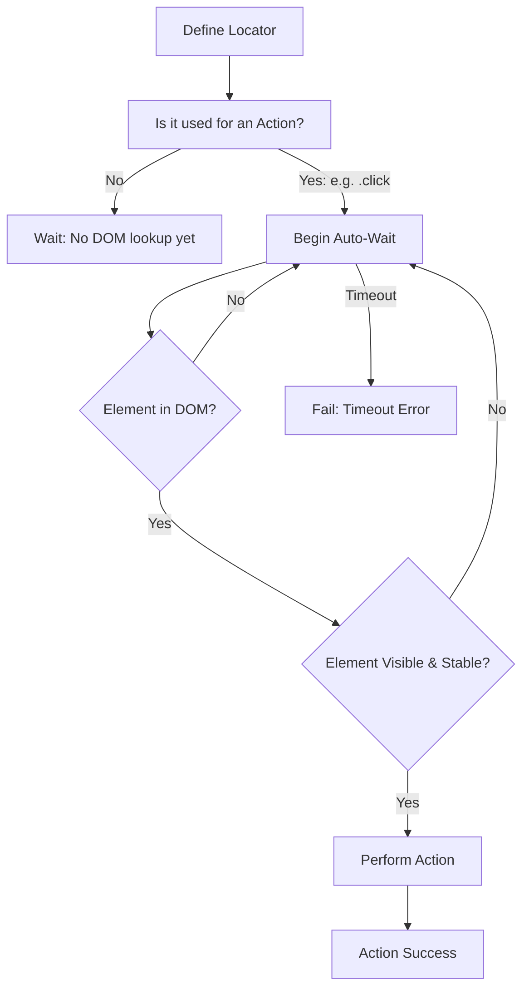

# Playwright Locators: The Modern Approach

## 🚀 Tutorial Overview
Playwright's locator engine is fundamentally different from Selenium's `findElement`. A Playwright **Locator** is a description of how to find an element on the page. It does not actually find the element until an action (like `click`) is performed. This "Lazy Loading" approach is what enables Playwright's resilient auto-waiting.

This tutorial focuses on the **Playwright-specific Locating API**, building on the theoretical foundations of CSS and XPath.

### Context within the Automation Lifecycle
- **Reliability:** Locators automatically wait for the element to become "actionable".
- **Semantic Testing:** Playwright encourages locating by user-facing attributes (Roles, Labels) rather than technical implementation (IDs, Classes).

---

## 📌 Core Theoretical Pillars

### 1. The Locator Object vs. ElementHandle
- **Locator (Recommended):** A pointer to an element. It re-finds the element every time it's used, preventing "Stale Element" exceptions.
- **ElementHandle (Legacy):** A direct reference to a DOM node. Discouraged in modern Playwright as it lacks auto-waiting.

### 2. Actionability Checks
Before interacting with a locator, Playwright ensures the element is:
- Visible
- Stable
- Enabled
- Attached to the DOM

---

## 🛠️ Step-by-Step Chronological Implementation

### Phase 1: Semantic Locators (The Playwright Way)
Playwright provides built-in locators that match how users perceive the UI.

```typescript
// Locating by Role (Recommended)
await page.getByRole('button', { name: 'Submit' }).click();

// Locating by Label (For forms)
await page.getByLabel('User Name').fill('sagar_sdet');

// Locating by Placeholder
await page.getByPlaceholder('Enter Password').fill('secret123');

// Locating by Test ID (Enterprise standard)
await page.getByTestId('login-submit').click();
```

### Phase 2: Chaining & Filtering
You can chain locators to narrow down the search without complex XPath.

```typescript
// Find a row that contains specific text, then find a button inside it
const row = page.locator('tr').filter({ hasText: 'Order #1234' });
await row.getByRole('button', { name: 'Delete' }).click();

// Locating items in a list
const firstItem = page.locator('ul > li').first();
const lastItem = page.locator('ul > li').last();
const nthItem = page.locator('ul > li').nth(2);
```

### Phase 3: Advanced Locator Strategies
Using regex and internal Playwright selectors.

```typescript
// Case-insensitive text match via Regex
await page.getByText(/log in/i).click();

// Locate by CSS (Standard)
await page.locator('.submit-btn').click();

// Locate by XPath (Last resort)
await page.locator('//button[contains(text(), "Save")]').click();
```

---

## 📊 Technical Component Encyclopedia

| Method | Purpose | Usage Example |
| :--- | :--- | :--- |
| `getByRole()` | Finds by ARIA role and name. | `page.getByRole('heading', { level: 1 })` |
| `getByText()` | Finds by visible text. | `page.getByText('Success', { exact: true })` |
| `getByLabel()` | Finds form field by `<label>`. | `page.getByLabel('Email')` |
| `getByPlaceholder()`| Finds by input placeholder. | `page.getByPlaceholder('Search...')` |
| `getByAltText()` | Finds images by alt attribute. | `page.getByAltText('Logo')` |
| `getByTitle()` | Finds by title attribute. | `page.getByTitle('Close')` |
| `getByTestId()` | Finds by `data-testid`. | `page.getByTestId('cart-icon')` |
| `.filter()` | Filters existing locator. | `locator.filter({ has: page.locator('span') })` |

---

## 🔄 Visual Workflow (Mermaid)



---

## 🏭 Real-World Industrial Patterns

### 1. The "Locators as Variables" Pattern
Avoid hardcoding strings inside test methods. Define them at the top or in a Page Object.

```typescript
export class LoginPage {
  readonly usernameInput = this.page.getByLabel('Username');
  readonly loginButton = this.page.getByRole('button', { name: 'Login' });

  async login(user: string) {
    await this.usernameInput.fill(user);
    await this.loginButton.click();
  }
}
```

### 2. Strict Mode
Playwright locators are **strict** by default. If a locator matches 2 elements, it will throw an error. This is a safety feature to ensure your tests are deterministic.

```typescript
// This will FAIL if there are multiple buttons
await page.locator('button').click(); 

// Fix: Be more specific
await page.getByRole('button', { name: 'Submit' }).click();
```

---
