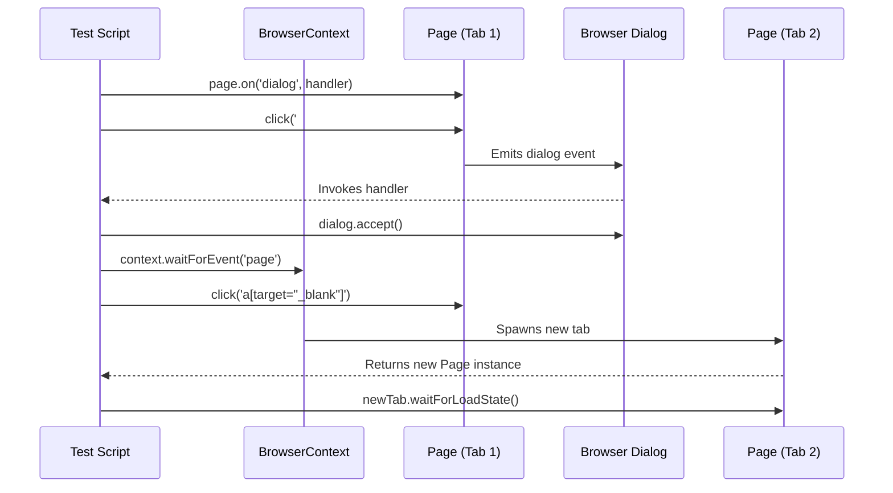

# Playwright & TypeScript: Advanced UI Interactions

### 1. 🚀 Tutorial Overview
Handling modern web applications requires navigating beyond simple clicks and text inputs. Advanced UI interactions encompass manipulating nested contexts (iframes), reacting to browser-native dialogs (alerts, prompts), managing multiple browser windows, transferring files, and simulating complex input device events (mouse tracking, keyboard chords).
Within the automation lifecycle, mastering these interactions is the differentiating factor between brittle, limited tests and robust, comprehensive end-to-end coverage.
**Prerequisites:** Mastery of Playwright Locators, basic understanding of the DOM structure, and familiarity with TypeScript asynchronous programming (`async`/`await`).

### 2. 📌 Core Theoretical Pillars
- **Context Isolation & Event Loops:** Playwright operates natively across the CDP (Chrome DevTools Protocol) or equivalent protocols for Firefox/WebKit. This out-of-process architecture means Playwright can listen to browser-level events (like `dialog` or `popup`) synchronously before they block the main UI thread.
- **Frame Execution Contexts:** Iframes represent separate DOMs. Playwright does not cross frame boundaries automatically when searching for elements; you must explicitly switch to the `FrameLocator` context to interact with elements inside an iframe.
- **Native OS File Handling:** File uploads and downloads bypass the standard DOM. Playwright hooks into the browser's download manager and file chooser APIs to intercept and handle these programmatically without OS-level popups.

### 3. 🛠️ Step-by-Step Chronological Implementation

#### Phase 1: The Foundations (Entry Level)

**1. Handling Simple Alerts and Dialogs**
By default, Playwright automatically dismisses alerts. To accept them or read their messages, you must attach a listener *before* the action that triggers the dialog.
```typescript
import { test, expect } from '@playwright/test';

test('Handle JS Alert', async ({ page }) => {
    // 1. Setup the listener
    page.on('dialog', async dialog => {
        expect(dialog.type()).toBe('alert');
        expect(dialog.message()).toContain('I am an alert box!');
        await dialog.accept(); 
    });

    // 2. Trigger the dialog
    await page.locator('button#alert-btn').click();
});
```

**2. Basic File Upload**
Use `setInputFiles` on an `<input type="file">` element.
```typescript
test('Simple File Upload', async ({ page }) => {
    await page.goto('https://example.com/upload');
    await page.locator('input[type="file"]').setInputFiles('tests/fixtures/sample.pdf');
});
```

#### Phase 2: Intermediate Configurations

**1. Interacting with Iframes**
Use `frameLocator` to pierce the iframe boundary.
```typescript
test('Interact inside an iframe', async ({ page }) => {
    await page.goto('https://example.com/iframe-page');
    
    // Locate the frame, then the element inside it
    const frame = page.frameLocator('#payment-frame');
    await frame.locator('input[name="card_number"]').fill('4111222233334444');
    await frame.locator('button.submit').click();
});
```

**2. Drag and Drop**
Playwright provides a high-level `dragTo` method that simulates a real mouse drag.
```typescript
test('Drag and Drop', async ({ page }) => {
    const source = page.locator('#draggable');
    const target = page.locator('#droppable');
    
    await source.dragTo(target);
});
```

**3. Handling File Chooser (No `<input type="file">`)**
When a button triggers the OS file picker, you must wait for the `filechooser` event.
```typescript
test('Handle File Chooser Event', async ({ page }) => {
    const [fileChooser] = await Promise.all([
        page.waitForEvent('filechooser'),
        page.locator('button#custom-upload').click()
    ]);
    
    await fileChooser.setFiles('tests/fixtures/image.png');
});
```

#### Phase 3: Professional Optimization (Senior Level)

**1. Multi-Window / Popup Handling**
Handling dynamic popups requires capturing the new `Page` instance created by the action.
```typescript
test('Handle Multiple Windows', async ({ context, page }) => {
    // Start waiting for the new page BEFORE clicking
    const pagePromise = context.waitForEvent('page');
    await page.locator('a[target="_blank"]').click();
    
    // Capture the new tab
    const newTab = await pagePromise;
    await newTab.waitForLoadState('domcontentloaded');
    
    expect(await newTab.title()).toEqual('New Window Title');
    await newTab.close(); // Clean up
});
```

**2. Complex Mouse and Keyboard Chords**
Simulating drawing or complex interactions using low-level APIs.
```typescript
test('Complex Mouse Drawing', async ({ page }) => {
    await page.goto('https://jspaint.app');
    
    // Move to start position
    await page.mouse.move(200, 200);
    await page.mouse.down(); // Press mouse button
    
    // Draw a square
    await page.mouse.move(400, 200, { steps: 10 });
    await page.mouse.move(400, 400, { steps: 10 });
    await page.mouse.move(200, 400, { steps: 10 });
    await page.mouse.move(200, 200, { steps: 10 });
    
    await page.mouse.up(); // Release mouse button
});

test('Keyboard Chords', async ({ page }) => {
    const input = page.locator('#search');
    await input.focus();
    
    // Type and select all
    await page.keyboard.type('Playwright Testing');
    
    // OS-specific modifier
    const modifier = process.platform === 'darwin' ? 'Meta' : 'Control';
    await page.keyboard.press(`${modifier}+A`);
    await page.keyboard.press('Backspace');
});
```

### 4. 📊 Technical Component Encyclopedia

| Component / Method | Source | Method Signature | Code Example |
| :--- | :--- | :--- | :--- |
| **`dialog.accept()`** | `Page` | `accept(promptText?: string): Promise<void>` | `dialog.accept('My Input');` |
| **`dialog.dismiss()`** | `Page` | `dismiss(): Promise<void>` | `dialog.dismiss();` |
| **`dialog.message()`** | `Page` | `message(): string` | `console.log(dialog.message());` |
| **`dialog.type()`** | `Page` | `type(): string` | `if(dialog.type() === 'prompt')` |
| **`setInputFiles()`** | `Locator` | `setInputFiles(files: string \| string[]): Promise<void>` | `loc.setInputFiles(['a.txt', 'b.txt']);` |
| **`waitForEvent('filechooser')`** | `Page` | `waitForEvent('filechooser'): Promise<FileChooser>` | `const [fc] = await Promise.all([page.waitForEvent('filechooser'), click()]);` |
| **`waitForEvent('page')`** | `BrowserContext` | `waitForEvent('page'): Promise<Page>` | `const newTab = await context.waitForEvent('page');` |
| **`dragTo()`** | `Locator` | `dragTo(target: Locator, options?: {}): Promise<void>` | `source.dragTo(target);` |
| **`mouse.move()`** | `Mouse` | `move(x: number, y: number, options?: { steps: number }): Promise<void>` | `await page.mouse.move(100, 100);` |
| **`mouse.down()` / `up()`** | `Mouse` | `down(options?: { button: 'left'\|'right'\|'middle' }): Promise<void>` | `await page.mouse.down({ button: 'right' });` |
| **`keyboard.press()`** | `Keyboard` | `press(key: string, options?: { delay: number }): Promise<void>` | `await page.keyboard.press('Shift+Enter');` |
| **`frameLocator()`** | `Page` | `frameLocator(selector: string): FrameLocator` | `page.frameLocator('iframe#auth');` |

### 5. 🔄 Visual Workflow (Mermaid)



### 6. 🏭 Real-World Industrial Patterns

**Dialog Handler Utility Class**
In enterprise frameworks, you want to abstract dialog handling so tests don't clutter themselves with event listeners.
```typescript
import { Page, Dialog } from '@playwright/test';

export class DialogManager {
    constructor(private page: Page) {}

    /**
     * Automatically accepts any incoming dialog with an optional prompt text.
     */
    async autoAcceptNextDialog(promptResponse?: string): Promise<void> {
        this.page.once('dialog', async (dialog: Dialog) => {
            console.log(`Intercepted dialog: [${dialog.type()}] ${dialog.message()}`);
            if (dialog.type() === 'prompt' && promptResponse) {
                await dialog.accept(promptResponse);
            } else {
                await dialog.accept();
            }
        });
    }

    /**
     * Automatically dismisses the next incoming dialog.
     */
    async autoDismissNextDialog(): Promise<void> {
        this.page.once('dialog', async (dialog: Dialog) => {
            console.log(`Dismissing dialog: ${dialog.message()}`);
            await dialog.dismiss();
        });
    }
}

// Usage in test:
// const dialogManager = new DialogManager(page);
// await dialogManager.autoAcceptNextDialog();
// await page.getByText('Delete Account').click();
```
