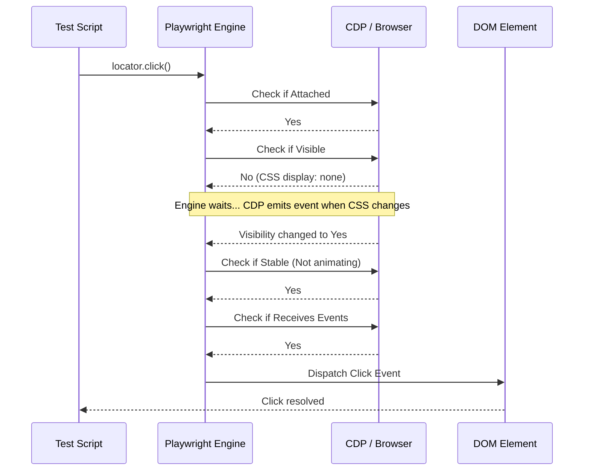

# Playwright & TypeScript: Synchronization and Waiting Strategies

### 1. 🚀 Tutorial Overview
One of the most notoriously difficult aspects of UI automation is "flakiness"—tests that pass locally but fail in CI due to timing issues. Playwright addresses this at a structural level through its **Auto-Waiting** capabilities. Unlike Selenium, which often required explicit loops or `Thread.sleep` equivalents, Playwright automatically waits for elements to be actionable before performing interactions.
Within the automation lifecycle, understanding *how* Playwright waits, and more importantly, knowing when to override or supplement these waits, is crucial for writing deterministic tests.
**Prerequisites:** Understanding of the DOM lifecycle (DOM content loaded, load, network idle) and Playwright's basic interactions.

### 2. 📌 Core Theoretical Pillars
- **Actionability Checks:** Before any action (like `.click()` or `.fill()`), Playwright performs a series of checks on the target element: Is it Attached to the DOM? Is it Visible? Is it Stable (not animating)? Is it Enabled? Is it capable of receiving Events (not obscured)? 
- **The Event Loop vs CDP:** Playwright does not poll the DOM blindly. It registers listeners over the CDP and is notified immediately when an element's state changes, making it exponentially faster and more reliable than traditional WebDriver polling.
- **Strict Mode:** Playwright enforces strictness. If a locator resolves to more than one element, it throws an error immediately rather than silently interacting with the wrong element.

### 3. 🛠️ Step-by-Step Chronological Implementation

#### Phase 1: The Foundations (Entry Level)

**1. Relying on Auto-Waiting**
In 90% of cases, you don't write any wait code. Playwright does it.
```typescript
test('Auto Waiting Example', async ({ page }) => {
    await page.goto('https://example.com');
    // If the button is fading in, Playwright waits up to the default timeout (30s)
    // for it to be visible, stable, and receive events.
    await page.locator('button.submit').click(); 
});
```

**2. Waiting for Page Load States**
Sometimes you need to ensure the page has reached a specific state before proceeding.
```typescript
test('Wait for Load State', async ({ page }) => {
    await page.goto('https://example.com');
    // Waits for all network connections to have been idle for at least 500 ms.
    await page.waitForLoadState('networkidle'); 
    
    // Or wait specifically for the DOM to be parsed
    await page.waitForLoadState('domcontentloaded');
});
```

#### Phase 2: Intermediate Configurations

**1. Waiting for Specific Elements**
Sometimes you aren't interacting with an element immediately, but you need to assert its presence or wait for it to disappear.
```typescript
test('Wait for Element State', async ({ page }) => {
    const loadingSpinner = page.locator('.spinner');
    
    // Wait for it to appear
    await loadingSpinner.waitFor({ state: 'visible' });
    
    // Perform some action...
    
    // Wait for it to be removed from the DOM or hidden
    await loadingSpinner.waitFor({ state: 'hidden' });
});
```

**2. Custom Timeouts**
Override the default 30s timeout for specific, slow actions.
```typescript
test('Custom Timeouts', async ({ page }) => {
    // Wait for a heavy report generation button up to 60 seconds
    await page.locator('#generate-report').click({ timeout: 60000 });
});
```

#### Phase 3: Professional Optimization (Senior Level)

**1. Waiting for Custom Predicates and API Responses**
Avoid `waitForTimeout` (hard sleeps). Instead, wait for the actual underlying condition to be met, such as an API call resolving.
```typescript
test('Wait for API Response', async ({ page }) => {
    // Start listening for the response BEFORE clicking
    const responsePromise = page.waitForResponse(response => 
        response.url().includes('/api/v1/users') && response.status() === 200
    );
    
    await page.locator('#fetch-users-btn').click();
    
    // Await the promise to resolve
    const response = await responsePromise;
    console.log(await response.json());
});
```

**2. Waiting for Custom JavaScript Functions (waitForFunction)**
When you need to wait for a complex state inside the browser's context that cannot be targeted by a DOM element.
```typescript
test('Wait for Custom JS State', async ({ page }) => {
    // Suppose a frontend app sets a global variable `window.__APP_READY__ = true`
    await page.waitForFunction(() => window['__APP_READY__'] === true);
    
    // Or wait for a specific complex DOM condition
    await page.waitForFunction(() => {
        const rows = document.querySelectorAll('.data-row');
        return rows.length === 50 && rows[49].textContent.includes('Loaded');
    });
});
```

### 4. 📊 Technical Component Encyclopedia

| Component / Method | Source | Method Signature | Code Example |
| :--- | :--- | :--- | :--- |
| **`waitFor()`** | `Locator` | `waitFor(options?: { state?: 'attached'\|'detached'\|'visible'\|'hidden', timeout?: number }): Promise<void>` | `loc.waitFor({ state: 'hidden' });` |
| **`waitForLoadState()`** | `Page` | `waitForLoadState(state?: 'load'\|'domcontentloaded'\|'networkidle', options?: { timeout?: number }): Promise<void>` | `page.waitForLoadState('networkidle');` |
| **`waitForResponse()`** | `Page` | `waitForResponse(urlOrPredicate: string\|RegExp\|function, options?: {}): Promise<Response>` | `page.waitForResponse('**/data');` |
| **`waitForRequest()`** | `Page` | `waitForRequest(urlOrPredicate: string\|RegExp\|function, options?: {}): Promise<Request>` | `page.waitForRequest(r => r.method() === 'POST');` |
| **`waitForFunction()`** | `Page` | `waitForFunction(pageFunction: function, arg?: any, options?: {}): Promise<JSHandle>` | `page.waitForFunction(() => window.ready);` |
| **`waitForTimeout()`** | `Page` | `waitForTimeout(timeout: number): Promise<void>` | `page.waitForTimeout(5000); // ANTI-PATTERN` |

### 5. 🔄 Visual Workflow (Mermaid)



### 6. 🏭 Real-World Industrial Patterns

**Smart Wait Wrapper for Dynamic SPAs**
In heavily dynamic Single Page Applications (SPAs), sometimes standard locators aren't enough, and you need a robust wrapper that waits for a combination of API stability and DOM readiness.
```typescript
import { Page, Locator } from '@playwright/test';

export class SyncHelper {
    constructor(private page: Page) {}

    /**
     * Clicks an element only after ensuring a specific background API call has resolved,
     * mitigating flakiness where an element is visible but the data isn't bound yet.
     */
    async clickAfterApiSync(locator: Locator, apiUrlSegment: string): Promise<void> {
        // Wait for the element to be visible and stable
        await locator.waitFor({ state: 'visible' });

        // Execute click and capture the resulting API call simultaneously
        const [response] = await Promise.all([
            this.page.waitForResponse(res => 
                res.url().includes(apiUrlSegment) && res.status() >= 200 && res.status() < 300
            ),
            locator.click()
        ]);
        
        console.log(`Successfully synced action with API: ${response.url()}`);
        
        // Wait for any subsequent loaders to disappear
        const loader = this.page.locator('.global-loader');
        if (await loader.isVisible()) {
            await loader.waitFor({ state: 'hidden' });
        }
    }
}
```
