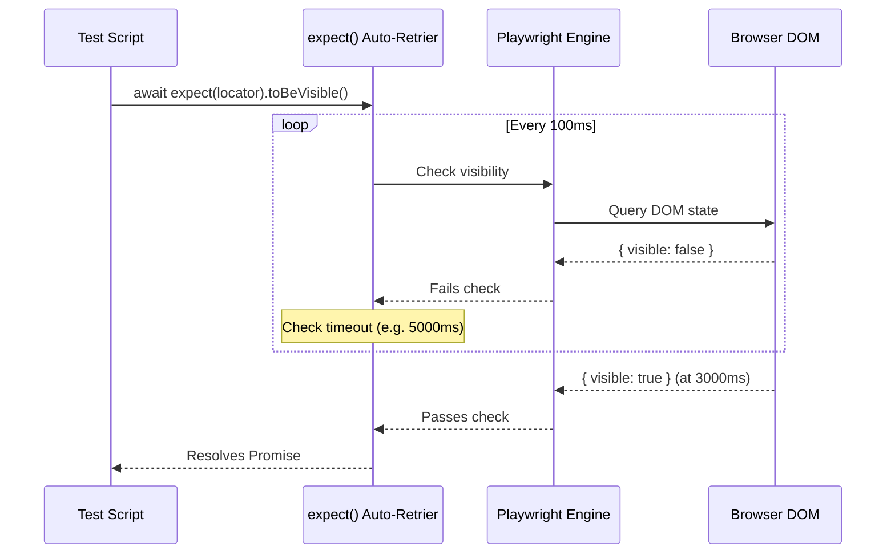

# Playwright & TypeScript: Assertions

### 1. 🚀 Tutorial Overview
Assertions are the core of any test. Playwright provides a custom `expect` library built upon Jest's `expect`, but fundamentally enhanced for the web. These are termed **Web-First Assertions**. Unlike standard assertions that fail immediately if a condition isn't met, Web-First assertions automatically poll and wait for the condition to become true up to a specified timeout.
Within the automation lifecycle, migrating from static assertions to auto-retrying assertions eliminates race conditions and significantly reduces test flakiness.
**Prerequisites:** Understanding of Locators and Playwright's auto-waiting principles.

### 2. 📌 Core Theoretical Pillars
- **Auto-Retrying (Polling):** When you use `await expect(locator).toBeVisible()`, Playwright does not just check visibility once. It continually polls the DOM until the element is visible or the timeout (default 5s) is reached.
- **Asynchronous vs Synchronous Expectations:** Web-First assertions *must* be `await`ed because they interact with the browser asynchronously. Standard Jest assertions (like `expect(1+1).toBe(2)`) are synchronous and do not require `await`.
- **Soft Assertions:** By default, a failed assertion halts the test immediately. Soft assertions log the failure but allow the test to continue executing, aggregating all errors at the end.

### 3. 🛠️ Step-by-Step Chronological Implementation

#### Phase 1: The Foundations (Entry Level)

**1. Basic Web-First Assertions**
Use `expect` with a `Locator` to verify states.
```typescript
import { test, expect } from '@playwright/test';

test('Basic Assertions', async ({ page }) => {
    await page.goto('https://example.com');
    const header = page.locator('h1');
    
    // Auto-retrying assertions (requires await)
    await expect(header).toBeVisible();
    await expect(header).toHaveText('Example Domain');
    await expect(page).toHaveURL('https://example.com/');
    await expect(page).toHaveTitle(/Example/);
});
```

**2. Synchronous (Value) Assertions**
Comparing static values fetched from the page.
```typescript
test('Static Assertions', async ({ page }) => {
    const count = await page.locator('.items').count();
    
    // No await needed for standard matchers
    expect(count).toBeGreaterThan(5); 
    expect('foo').toEqual('foo');
});
```

#### Phase 2: Intermediate Configurations

**1. Soft Assertions**
Use `expect.soft` to prevent the test from aborting on the first failure.
```typescript
test('Soft Assertions', async ({ page }) => {
    await page.goto('https://example.com/form');
    
    // If this fails, the test continues
    await expect.soft(page.locator('#firstname')).toBeEmpty();
    await expect.soft(page.locator('#lastname')).toBeEmpty();
    
    // The test will ultimately fail at the end if any soft assertion failed
    await page.locator('button.submit').click();
});
```

**2. Custom Timeout and Polling intervals**
Modify the timeout for a specific, slow assertion.
```typescript
test('Custom Assertion Timeout', async ({ page }) => {
    // Wait up to 15 seconds for a complex element to contain specific text
    await expect(page.locator('.status')).toHaveText('Complete', { timeout: 15000 });
});
```

#### Phase 3: Professional Optimization (Senior Level)

**1. Polling Arbitrary Functions (toPass)**
Sometimes you need to retry an entire block of code, not just a single locator. Use `expect(poll).toPass()`.
```typescript
test('Polling Complex Blocks', async ({ page }) => {
    await expect(async () => {
        const response = await page.request.get('/api/status');
        const json = await response.json();
        
        // This entire block will retry until all standard assertions pass
        expect(json.status).toBe('ready');
        expect(json.items.length).toBeGreaterThan(0);
    }).toPass({
        intervals: [100, 250, 500, 1000], // Custom backoff polling
        timeout: 10000
    });
});
```

**2. Custom Matchers**
Extend the `expect` library to create domain-specific assertions.
```typescript
import { expect as baseExpect } from '@playwright/test';

// Extend expect
const expect = baseExpect.extend({
    async toBeValidEmail(locator, expectedDomain) {
        const emailText = await locator.textContent();
        const pass = emailText?.includes(`@${expectedDomain}`) ?? false;
        if (pass) {
            return { message: () => 'passed', pass: true };
        } else {
            return { message: () => `expected ${emailText} to be a valid ${expectedDomain} email`, pass: false };
        }
    },
});

test('Custom Matcher', async ({ page }) => {
    const emailField = page.locator('.user-email');
    await expect(emailField).toBeValidEmail('company.com');
});
```

### 4. 📊 Technical Component Encyclopedia

| Component / Matcher | Target Type | Method Signature | Code Example |
| :--- | :--- | :--- | :--- |
| **`toBeVisible()`** | `Locator` | `toBeVisible(options?: { timeout?: number })` | `await expect(loc).toBeVisible();` |
| **`toBeHidden()`** | `Locator` | `toBeHidden()` | `await expect(loc).toBeHidden();` |
| **`toHaveText()`** | `Locator` | `toHaveText(expected: string\|RegExp, options?)` | `await expect(loc).toHaveText(/Hello/);` |
| **`toContainText()`** | `Locator` | `toContainText(expected: string\|RegExp)` | `await expect(loc).toContainText('foo');` |
| **`toHaveAttribute()`** | `Locator` | `toHaveAttribute(name: string, value: string\|RegExp)` | `await expect(loc).toHaveAttribute('type', 'text');` |
| **`toHaveClass()`** | `Locator` | `toHaveClass(expected: string\|RegExp)` | `await expect(loc).toHaveClass(/active/);` |
| **`toHaveCount()`** | `Locator` | `toHaveCount(count: number)` | `await expect(page.locator('li')).toHaveCount(3);` |
| **`toBeEnabled()`** | `Locator` | `toBeEnabled()` | `await expect(loc).toBeEnabled();` |
| **`toBeDisabled()`** | `Locator` | `toBeDisabled()` | `await expect(loc).toBeDisabled();` |
| **`toHaveURL()`** | `Page` | `toHaveURL(expected: string\|RegExp)` | `await expect(page).toHaveURL('**/login');` |
| **`toHaveTitle()`** | `Page` | `toHaveTitle(expected: string\|RegExp)` | `await expect(page).toHaveTitle('Home');` |
| **`toPass()`** | `Function` | `toPass(options?: { timeout?: number, intervals?: number[] })` | `await expect(async () => {...}).toPass();` |

### 5. 🔄 Visual Workflow (Mermaid)



### 6. 🏭 Real-World Industrial Patterns

**Assertion Wrapping for Enhanced Logging**
In an enterprise framework, you might want assertions to automatically log to Allure or an internal reporting tool. You can wrap Playwright's `test.step` around assertions.

```typescript
import { test, expect, Locator } from '@playwright/test';

export class AssertionsHelper {
    /**
     * Asserts visibility and logs the action into the HTML/Allure report.
     */
    static async assertVisible(locator: Locator, elementName: string): Promise<void> {
        await test.step(`Verify [${elementName}] is visible`, async () => {
            await expect(locator, `Expected ${elementName} to be visible`).toBeVisible();
        });
    }

    /**
     * Asserts exact text match with reporting.
     */
    static async assertTextEquals(locator: Locator, expectedText: string, elementName: string): Promise<void> {
        await test.step(`Verify [${elementName}] text is exactly "${expectedText}"`, async () => {
            await expect(locator).toHaveText(expectedText);
        });
    }
}

// Usage in Test:
// await AssertionsHelper.assertVisible(page.locator('#submit'), 'Submit Button');
```
