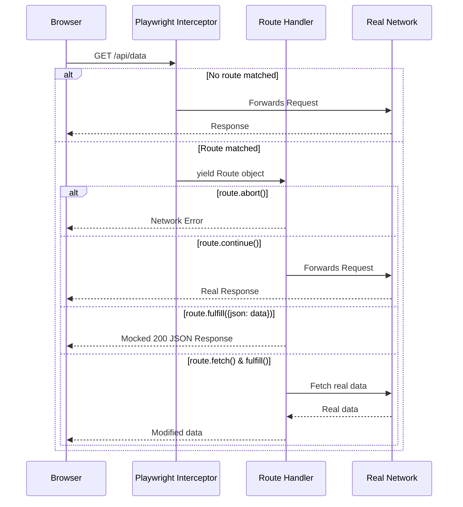

# Playwright & TypeScript: Network Interception and Mocking

### 1. 🚀 Tutorial Overview
Modern Single Page Applications (SPAs) rely heavily on background APIs (REST, GraphQL). Testing the UI layer in isolation requires controlling these API responses. Playwright provides built-in network interception, allowing you to monitor, modify, block, or mock network requests and responses without external proxies (like Charles or Fiddler).
Within the automation lifecycle, network mocking allows you to test edge cases (500 Server Errors, empty data arrays) that are difficult or impossible to reproduce using real backend environments.
**Prerequisites:** Understanding of HTTP protocols, REST APIs, JSON parsing, and Promises in TypeScript.

### 2. 📌 Core Theoretical Pillars
- **The Route Object:** When network interception is enabled via `page.route()`, Playwright pauses the request and hands a `Route` object to your handler. You must then explicitly choose to `fulfill()` (mock), `continue()` (let it pass), or `abort()` (block) the request.
- **Pattern Matching:** Interception can be scoped globally (via `browserContext.route`) or per page (`page.route`). You use string matching (`**/api/*`) or Regex to target specific requests.
- **Execution Order:** Network routing intercepts the request *before* it hits the network, allowing you to manipulate headers, bodies, or bypass the network entirely.

### 3. 🛠️ Step-by-Step Chronological Implementation

#### Phase 1: The Foundations (Entry Level)

**1. Blocking Requests**
A common use case is blocking analytics or heavy assets (images) to speed up tests.
```typescript
import { test, expect } from '@playwright/test';

test('Block Images to Speed Up Loading', async ({ page }) => {
    // Intercept all requests ending in png, jpg, jpeg
    await page.route('**/*.{png,jpg,jpeg}', route => route.abort());
    
    await page.goto('https://example.com/heavy-image-page');
    // Page loads instantly without downloading images
});
```

**2. Basic Mocking (Stubbing Responses)**
Intercept a request and return a hardcoded JSON response.
```typescript
test('Mock API Response', async ({ page }) => {
    await page.route('**/api/v1/users', async route => {
        const json = { users: [{ id: 1, name: 'Mocked User' }] };
        await route.fulfill({ json });
    });

    await page.goto('https://example.com/users');
    
    // The UI will display "Mocked User" instead of real data
    await expect(page.locator('.user-name')).toHaveText('Mocked User');
});
```

#### Phase 2: Intermediate Configurations

**1. Modifying a Real Response**
Sometimes you want the real data, but need to tweak a specific field. You can fetch the real response inside the route handler, modify it, and pass it back.
```typescript
test('Modify Real API Response', async ({ page }) => {
    await page.route('**/api/config', async route => {
        // Fetch original response
        const response = await route.fetch();
        const json = await response.json();
        
        // Modify the payload
        json.features.betaEnabled = true;
        
        // Fulfill with modified payload
        await route.fulfill({ response, json });
    });
    
    await page.goto('https://example.com');
    // The UI will now render beta features
});
```

**2. Mocking with Static Files**
Store large JSON mocks in fixture files and serve them dynamically.
```typescript
test('Mock using File System', async ({ page }) => {
    await page.route('**/api/data', async route => {
        await route.fulfill({ path: 'tests/mocks/large-dataset.json' });
    });
});
```

#### Phase 3: Professional Optimization (Senior Level)

**1. Context-Level Routing vs Page-Level Routing**
If you need mocking across all pages and tabs in a test, apply routing to the context.
```typescript
test('Context Level Mocking', async ({ context, page }) => {
    await context.route('**/tracking', route => route.abort());
    
    // All pages in this context will block tracking calls
    const page2 = await context.newPage();
});
```

**2. Removing Routes Dynamically**
Sometimes you mock a request for the first load, but want subsequent calls to hit the real network.
```typescript
test('Unroute Dynamically', async ({ page }) => {
    const handler = async (route) => {
        await route.fulfill({ status: 500, body: 'Server Down' });
    };

    // Apply route
    await page.route('**/api/save', handler);
    await page.locator('#save-btn').click();
    await expect(page.locator('.error')).toBeVisible();

    // Remove route (unroute)
    await page.unroute('**/api/save', handler);
    
    // Now it hits the real backend
    await page.locator('#save-btn').click();
    await expect(page.locator('.success')).toBeVisible();
});
```

### 4. 📊 Technical Component Encyclopedia

| Component / Method | Source | Method Signature | Code Example |
| :--- | :--- | :--- | :--- |
| **`page.route()`** | `Page` | `route(url: string\|RegExp, handler: function): Promise<void>` | `page.route('**/users', route => route.fulfill({ json }));` |
| **`page.unroute()`** | `Page` | `unroute(url: string\|RegExp, handler?: function): Promise<void>` | `page.unroute('**/users');` |
| **`route.fulfill()`** | `Route` | `fulfill(options?: { status?: number, headers?: {}, body?: string, json?: any, path?: string, response?: APIResponse }): Promise<void>` | `route.fulfill({ status: 404 });` |
| **`route.abort()`** | `Route` | `abort(errorCode?: string): Promise<void>` | `route.abort('failed');` |
| **`route.continue()`** | `Route` | `continue(options?: { headers?: {}, method?: string, postData?: any }): Promise<void>` | `route.continue({ method: 'POST' });` |
| **`route.fetch()`** | `Route` | `fetch(options?: {}): Promise<APIResponse>` | `const res = await route.fetch();` |

### 5. 🔄 Visual Workflow (Mermaid)



### 6. 🏭 Real-World Industrial Patterns

**Mocking Utility Factory**
In enterprise applications, tests shouldn't define JSON blobs inline. You build a `MockManager` to handle stateful mocks easily.

```typescript
import { Page } from '@playwright/test';

export class MockManager {
    constructor(private page: Page) {}

    /**
     * Mocks a GraphQL endpoint by filtering the operationName.
     */
    async mockGraphQL(operationName: string, mockData: any): Promise<void> {
        await this.page.route('**/graphql', async route => {
            const requestBody = route.request().postDataJSON();
            
            // Check if this is the target query/mutation
            if (requestBody && requestBody.operationName === operationName) {
                await route.fulfill({
                    status: 200,
                    contentType: 'application/json',
                    json: { data: mockData }
                });
            } else {
                // Let other GraphQL calls pass through
                await route.continue();
            }
        });
    }

    /**
     * Simulates a critical backend failure.
     */
    async simulate500Error(endpointRegex: RegExp): Promise<void> {
        await this.page.route(endpointRegex, async route => {
            await route.fulfill({
                status: 500,
                contentType: 'application/json',
                json: { error: 'Internal Server Error simulated by Playwright' }
            });
        });
    }
}

// Usage in Test:
// const mocks = new MockManager(page);
// await mocks.mockGraphQL('GetUserDetails', { user: { role: 'admin' } });
```
