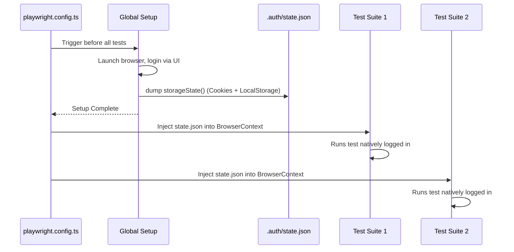

# Playwright & TypeScript: Storage State and Authentication

### 1. 🚀 Tutorial Overview
End-to-End tests often require authentication (login). Performing a full UI login for every single test in a suite of hundreds of tests is an anti-pattern—it's incredibly slow and prone to UI flakiness. Playwright solves this elegantly by allowing you to extract the authenticated browser state (Cookies, LocalStorage, SessionStorage) after a single login, save it to a JSON file, and inject it into all subsequent tests.
Within the automation lifecycle, implementing `storageState` reuse is the primary performance optimization for large test suites.
**Prerequisites:** Understanding of HTTP Cookies, Web Storage API (LocalStorage), and Playwright Global Setup mechanisms.

### 2. 📌 Core Theoretical Pillars
- **Browser Context Isolation:** Every Playwright test runs in an isolated `BrowserContext` (the equivalent of an Incognito window). This means no cookies or cache are shared between tests by default.
- **The `storageState` Object:** Playwright provides APIs to dump the state of a context (`context.storageState()`) into a JSON file, and another API to instantiate a new context *pre-loaded* with that JSON file.
- **Global Setup:** Playwright provides a `globalSetup` hook in its configuration that runs *once* before all tests. This is the optimal place to perform the UI login and generate the `storageState.json` file.

### 3. 🛠️ Step-by-Step Chronological Implementation

#### Phase 1: The Foundations (Entry Level)

**1. Basic Authentication in a Test (No Reuse)**
The slow, standard way.
```typescript
import { test, expect } from '@playwright/test';

test('Test requiring login', async ({ page }) => {
    // 1. Perform login
    await page.goto('https://example.com/login');
    await page.locator('#username').fill('admin');
    await page.locator('#password').fill('password123');
    await page.locator('button[type="submit"]').click();
    
    // 2. Perform test
    await expect(page.locator('.dashboard')).toBeVisible();
});
```

**2. Saving State Manually**
Saving the state after a successful login inside a test.
```typescript
test('Save Auth State', async ({ page, context }) => {
    await page.goto('https://example.com/login');
    // ... complete login ...
    
    // Wait for the auth cookie to be set (important!)
    await page.waitForURL('**/dashboard');
    
    // Dump state to file
    await context.storageState({ path: 'auth.json' });
});
```

#### Phase 2: Intermediate Configurations

**1. Reusing State Globally via Config**
Instead of manually injecting it, you can tell Playwright to use `auth.json` for all tests by default.

*In `playwright.config.ts`:*
```typescript
import { defineConfig } from '@playwright/test';

export default defineConfig({
  use: {
    // All tests will now start with this state pre-loaded
    storageState: 'auth.json', 
  },
});
```

**2. Overriding State for Specific Tests**
If you have tests that need to verify the *unauthenticated* state (e.g., login failure tests), you must clear the state.
```typescript
test.use({ storageState: { cookies: [], origins: [] } }); // Clear state

test('Invalid Login Test', async ({ page }) => {
    // This test runs as a fresh, logged-out user
    await page.goto('/login');
});
```

#### Phase 3: Professional Optimization (Senior Level)

**1. Global Setup (Enterprise Auth Pattern)**
You don't want to run a test just to generate the state. Use `globalSetup`.

*Create `global-setup.ts`:*
```typescript
import { chromium, FullConfig } from '@playwright/test';

async function globalSetup(config: FullConfig) {
  const browser = await chromium.launch();
  const page = await browser.newPage();
  
  await page.goto('https://example.com/login');
  await page.locator('#username').fill(process.env.ADMIN_USER!);
  await page.locator('#password').fill(process.env.ADMIN_PASS!);
  await page.locator('#submit').click();
  
  // Wait until the page confirms login
  await page.waitForURL('**/dashboard');
  
  // Save state
  await page.context().storageState({ path: 'playwright/.auth/admin.json' });
  await browser.close();
}
export default globalSetup;
```
*In `playwright.config.ts`:*
```typescript
export default defineConfig({
  globalSetup: require.resolve('./global-setup'),
  use: {
    storageState: 'playwright/.auth/admin.json',
  },
});
```

**2. Multi-Role Authentication Setup**
If your app has Users, Admins, and SuperAdmins, you can use Playwright Projects to segment auth, or create custom fixtures to load specific roles.

*In `playwright.config.ts`:*
```typescript
projects: [
  {
    name: 'admin-tests',
    use: { storageState: '.auth/admin.json' },
  },
  {
    name: 'user-tests',
    use: { storageState: '.auth/user.json' },
  },
]
```

### 4. 📊 Technical Component Encyclopedia

| Component / Method | Source | Method Signature | Code Example |
| :--- | :--- | :--- | :--- |
| **`storageState()`** | `BrowserContext` | `storageState(options?: { path?: string }): Promise<StorageState>` | `await context.storageState({ path: 'state.json' });` |
| **`test.use()`** | `Test API` | `use(options: TestOptions): void` | `test.use({ storageState: 'other.json' });` |
| **`clearCookies()`** | `BrowserContext` | `clearCookies(): Promise<void>` | `await context.clearCookies();` |
| **`addCookies()`** | `BrowserContext` | `addCookies(cookies: Cookie[]): Promise<void>` | `await context.addCookies([{name: 'auth', value: 'token', domain: '.app.com', path: '/'}]);` |
| **`cookies()`** | `BrowserContext` | `cookies(urls?: string\|string[]): Promise<Cookie[]>` | `const cookies = await context.cookies();` |
| **`globalSetup`** | `Config` | `globalSetup: string` | `globalSetup: require.resolve('./setup.ts')` |

### 5. 🔄 Visual Workflow (Mermaid)



### 6. 🏭 Real-World Industrial Patterns

**API-Based Global Authentication**
The ultimate optimization is to bypass the UI completely during `globalSetup` and use Playwright's `APIRequestContext` to fetch the auth token and inject it into the storage state file.

*In `global-setup.ts`:*
```typescript
import { request, FullConfig } from '@playwright/test';

async function globalSetup(config: FullConfig) {
  // 1. Create a headless API context
  const context = await request.newContext();
  
  // 2. Perform the POST login request
  const response = await context.post('https://api.example.com/v1/login', {
    data: {
      username: 'admin',
      password: 'supersecretpassword'
    }
  });
  
  const authPayload = await response.json();
  
  // 3. Manually construct the storageState JSON structure
  const state = {
    cookies: [],
    origins: [
      {
        origin: 'https://app.example.com',
        localStorage: [
          {
            name: 'authToken',
            value: authPayload.token
          }
        ]
      }
    ]
  };
  
  // 4. Write it to disk using Node's fs module
  import * as fs from 'fs';
  fs.writeFileSync('playwright/.auth/api-state.json', JSON.stringify(state));
}
export default globalSetup;
```
