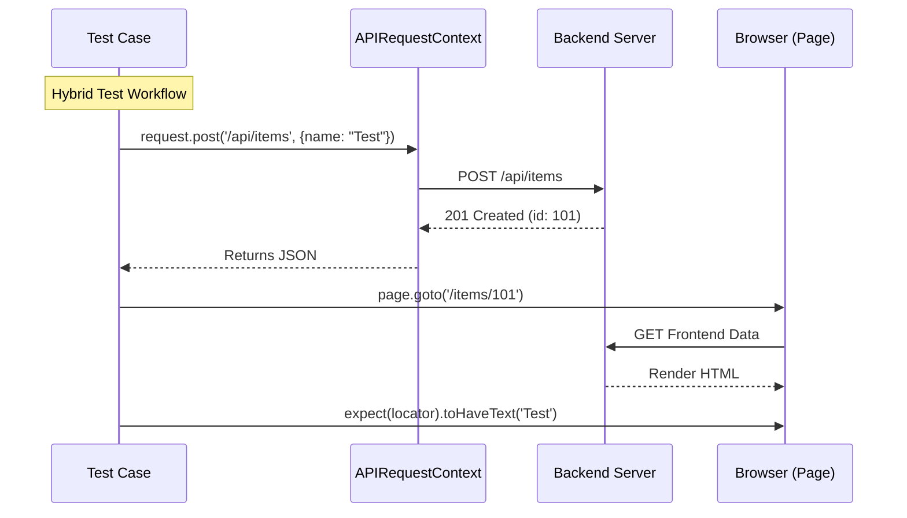

# Playwright & TypeScript: API Testing with Playwright

### 1. 🚀 Tutorial Overview
While Playwright is famous for UI automation, it possesses a fully functional, highly optimized, built-in API testing engine via the `APIRequestContext`. This means you do *not* need external libraries like Axios, Supertest, or RestAssured.js to perform backend validations or setup test data.
Within the automation lifecycle, combining API requests with UI tests allows for "Hybrid Testing"—where slow UI setups (creating a user via the UI) are replaced with lightning-fast API calls, leaving the UI test to focus purely on the frontend logic.
**Prerequisites:** Understanding of RESTful architecture, HTTP Methods (GET, POST, PUT, DELETE), headers, and JSON.

### 2. 📌 Core Theoretical Pillars
- **`request` Fixture:** Playwright provides a built-in `request` fixture in every test. It automatically inherits the `baseURL` and authentication state (cookies) from the current `BrowserContext`.
- **Zero-Dependency API Testing:** Because it's built into Playwright, you can use the exact same `expect` assertions, reporting, and parallelization for both UI and API tests.
- **Hybrid Testing Architecture:** The golden rule of modern SDET practices: *Only use the UI to test the UI.* If a test requires a product to exist before checking out, create the product via API, then navigate to the checkout page via UI.

### 3. 🛠️ Step-by-Step Chronological Implementation

#### Phase 1: The Foundations (Entry Level)

**1. Simple GET Request**
Performing a basic GET request and asserting the status code.
```typescript
import { test, expect } from '@playwright/test';

test('Basic GET Request', async ({ request }) => {
    const response = await request.get('https://reqres.in/api/users/2');
    
    // Assert status
    expect(response.status()).toBe(200);
    expect(response.ok()).toBeTruthy(); // ok() is true for 200-299 statuses
    
    // Parse and assert body
    const json = await response.json();
    expect(json.data.first_name).toBe('Janet');
});
```

**2. Simple POST Request**
Sending a JSON body and validating the response.
```typescript
test('Basic POST Request', async ({ request }) => {
    const response = await request.post('https://reqres.in/api/users', {
        data: {
            name: "morpheus",
            job: "leader"
        }
    });
    
    expect(response.status()).toBe(201);
    const body = await response.json();
    expect(body).toHaveProperty('id');
});
```

#### Phase 2: Intermediate Configurations

**1. Passing Headers and Query Parameters**
Most enterprise APIs require Bearer tokens or specific headers.
```typescript
test('Headers and Query Params', async ({ request }) => {
    const response = await request.get('https://api.github.com/user/repos', {
        headers: {
            'Authorization': `Bearer ${process.env.GITHUB_TOKEN}`,
            'Accept': 'application/vnd.github.v3+json'
        },
        params: {
            sort: 'updated',
            direction: 'desc'
        }
    });
    
    expect(response.ok()).toBeTruthy();
});
```

**2. Handling Form Data and File Uploads via API**
Testing multipart/form-data endpoints.
```typescript
import * as fs from 'fs';
import * as path from 'path';

test('Multipart File Upload API', async ({ request }) => {
    const filePath = path.resolve(__dirname, 'test.png');
    
    const response = await request.post('/api/upload', {
        multipart: {
            fileField: fs.createReadStream(filePath),
            description: 'My test image'
        }
    });
    
    expect(response.status()).toBe(200);
});
```

#### Phase 3: Professional Optimization (Senior Level)

**1. Hybrid Test: API Setup + UI Assertion**
This is the most powerful pattern in Playwright.
```typescript
test('Create entity via API, assert in UI', async ({ page, request }) => {
    // 1. Arrange: Create data lightning fast via API
    const createRes = await request.post('/api/v1/tickets', {
        data: { title: 'Auth Issue', priority: 'High' }
    });
    expect(createRes.status()).toBe(201);
    const ticket = await createRes.json();

    // 2. Act: Navigate directly to the newly created entity in the UI
    await page.goto(`/tickets/${ticket.id}`);

    // 3. Assert: Verify the UI renders the backend data correctly
    await expect(page.locator('.ticket-title')).toHaveText('Auth Issue');
    await expect(page.locator('.ticket-priority')).toHaveText('High');
});
```

**2. Request Context Isolation**
If you need to make API calls as a *different* user than the one currently logged into the UI context, you create an isolated context.
```typescript
import { request as apiRequest } from '@playwright/test';

test('Isolated Context Request', async ({ page }) => {
    // page is logged in as User A
    
    // Create a separate context for an Admin API call
    const adminContext = await apiRequest.newContext({
        extraHTTPHeaders: { 'Authorization': `Bearer ${adminToken}` }
    });
    
    await adminContext.delete('/api/users/123');
    await adminContext.dispose(); // Always dispose custom contexts
});
```

### 4. 📊 Technical Component Encyclopedia

| Component / Method | Source | Method Signature | Code Example |
| :--- | :--- | :--- | :--- |
| **`request.get()`** | `APIRequestContext`| `get(url: string, options?: { headers?, params? })` | `request.get('/data', { params: { id: 1 } });` |
| **`request.post()`** | `APIRequestContext`| `post(url: string, options?: { data?, multipart? })` | `request.post('/user', { data: { name: 'Bob' } });` |
| **`request.put()`** | `APIRequestContext`| `put(url: string, options?: { data? })` | `request.put('/user/1', { data: { name: 'Alice' } });` |
| **`request.delete()`**| `APIRequestContext`| `delete(url: string, options?: { data? })` | `request.delete('/user/1');` |
| **`response.ok()`** | `APIResponse` | `ok(): boolean` | `expect(response.ok()).toBeTruthy();` |
| **`response.status()`**| `APIResponse` | `status(): number` | `expect(response.status()).toBe(200);` |
| **`response.json()`** | `APIResponse` | `json(): Promise<any>` | `const data = await response.json();` |
| **`response.text()`** | `APIResponse` | `text(): Promise<string>` | `const bodyString = await response.text();` |
| **`request.newContext()`**| `playwright` | `newContext(options?: {}): Promise<APIRequestContext>`| `const ctx = await request.newContext();` |

### 5. 🔄 Visual Workflow (Mermaid)



### 6. 🏭 Real-World Industrial Patterns

**API Client Wrapper Class**
In enterprise frameworks, you abstract the `APIRequestContext` into domain-specific clients to hide URL structures and headers from the tests.

```typescript
import { APIRequestContext, expect } from '@playwright/test';

export class UserApiClient {
    constructor(private request: APIRequestContext) {}

    /**
     * Creates a user and guarantees a 201 status, abstracting the assertion.
     */
    async createUser(payload: { email: string, role: string }): Promise<any> {
        const response = await this.request.post('/api/v2/users', {
            data: payload,
            headers: { 'X-Source': 'Playwright-Automation' }
        });
        
        expect(response.status(), `Expected User creation to succeed, got ${response.status()}`).toBe(201);
        return response.json();
    }

    /**
     * Cleans up a user by ID. Used heavily in test teardowns.
     */
    async deleteUser(userId: string): Promise<void> {
        const response = await this.request.delete(`/api/v2/users/${userId}`);
        expect(response.ok(), 'Cleanup failed!').toBeTruthy();
    }
}

// Usage in Test:
// const userApi = new UserApiClient(request);
// const user = await userApi.createUser({ email: 'test@test.com', role: 'admin' });
// ... do UI tests ...
// await userApi.deleteUser(user.id);
```
