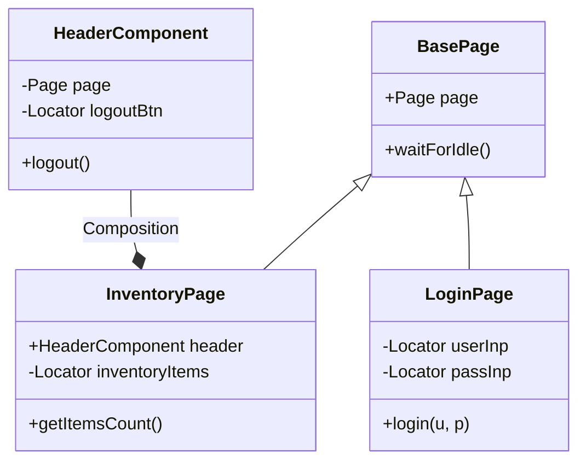

# Framework Architecture: Page Object Model (POM) in Playwright

### 1. 🚀 Tutorial Overview
The Page Object Model (POM) is the undisputed industry standard design pattern for UI automation. Its purpose is to separate the *test logic* (assertions, data) from the *page representation* (locators, interaction methods). When the UI changes, you update the Page Object once, rather than updating fifty broken tests.
Within the automation lifecycle, transitioning from procedural scripts to a well-architected POM is what elevates a project from a "script folder" to an "enterprise framework."
**Prerequisites:** Advanced TypeScript (Classes, Interfaces, Constructors, Inheritance), and Playwright Locators.

### 2. 📌 Core Theoretical Pillars
- **Encapsulation:** Locators should be `private` or `readonly` properties of the class. The test script should never directly interact with locators; it should call public methods (e.g., `loginPage.submitCredentials()`).
- **Composition over Inheritance:** While a `BasePage` is common, modern POM heavily utilizes Components (e.g., `HeaderComponent`, `TableComponent`) that are instantiated within the main Page Object, rather than deep inheritance trees.
- **Fluent Interfaces (Method Chaining):** Advanced implementations return the current `this` instance or a new Page instance from methods, allowing the test to chain actions: `await loginPage.enterUser('admin').enterPass('123').submit()`.

### 3. 🛠️ Step-by-Step Chronological Implementation

#### Phase 1: The Foundations (Entry Level)

**1. A Standard Page Object**
The simplest implementation using constructor initialization.
```typescript
// pages/LoginPage.ts
import { Page, Locator } from '@playwright/test';

export class LoginPage {
    readonly page: Page;
    readonly usernameInput: Locator;
    readonly passwordInput: Locator;
    readonly loginButton: Locator;

    constructor(page: Page) {
        this.page = page;
        this.usernameInput = page.locator('#user-name');
        this.passwordInput = page.locator('#password');
        this.loginButton = page.locator('#login-button');
    }

    async goto() {
        await this.page.goto('https://www.saucedemo.com/');
    }

    async login(user: string, pass: string) {
        await this.usernameInput.fill(user);
        await this.passwordInput.fill(pass);
        await this.loginButton.click();
    }
}
```
*Test Usage:*
```typescript
test('Basic POM Login', async ({ page }) => {
    const loginPage = new LoginPage(page);
    await loginPage.goto();
    await loginPage.login('standard_user', 'secret_sauce');
});
```

#### Phase 2: Intermediate Configurations

**1. The Base Page Pattern**
Create a `BasePage` to hold common functionality (e.g., waiting for loaders, capturing screenshots) that all other pages extend.
```typescript
// pages/BasePage.ts
import { Page, Locator } from '@playwright/test';

export class BasePage {
    constructor(public readonly page: Page) {}

    async waitForNetworkIdle() {
        await this.page.waitForLoadState('networkidle');
    }

    async getPageTitle(): Promise<string> {
        return this.page.title();
    }
}

// pages/DashboardPage.ts
export class DashboardPage extends BasePage {
    readonly title: Locator;

    constructor(page: Page) {
        super(page); // Must call super!
        this.title = page.locator('.title');
    }
}
```

**2. Component Objects**
A Header exists on every page. Instead of redefining it, create a `HeaderComponent`.
```typescript
// components/HeaderComponent.ts
export class HeaderComponent {
    constructor(private page: Page) {}
    
    async logout() {
        await this.page.locator('#react-burger-menu-btn').click();
        await this.page.locator('#logout_sidebar_link').click();
    }
}

// pages/InventoryPage.ts
export class InventoryPage extends BasePage {
    readonly header: HeaderComponent;

    constructor(page: Page) {
        super(page);
        this.header = new HeaderComponent(page);
    }
}
```

#### Phase 3: Professional Optimization (Senior Level)

**1. Fluent Interfaces (Method Chaining)**
Return `this` to allow chaining. Return a *new* Page Object when an action causes a navigation.
```typescript
// pages/LoginPage.ts
export class LoginPage {
    // ... constructor ...

    async enterUsername(user: string): Promise<this> {
        await this.usernameInput.fill(user);
        return this;
    }

    async enterPassword(pass: string): Promise<this> {
        await this.passwordInput.fill(pass);
        return this;
    }

    // Returns the NEXT page object
    async clickSubmit(): Promise<InventoryPage> {
        await this.loginButton.click();
        return new InventoryPage(this.page);
    }
}
```
*Test Usage:*
```typescript
test('Fluent POM Login', async ({ page }) => {
    const loginPage = new LoginPage(page);
    await loginPage.goto();
    
    // Highly readable, chained test logic
    const inventoryPage = await loginPage
        .enterUsername('admin')
        .then(p => p.enterPassword('123'))
        .then(p => p.clickSubmit());
        
    await expect(inventoryPage.title).toBeVisible();
});
```
*(Note: Because of `await`, fluent chaining in JS/TS often requires `.then()` wrappers, or you await each line individually which is generally preferred for stack trace clarity).*

**2. Custom Fixtures for Page Objects**
Injecting Page Objects directly into the test parameters so you don't have to instantiate them manually in every test (`new LoginPage(page)`).
```typescript
// fixtures/test-base.ts
import { test as base } from '@playwright/test';
import { LoginPage } from '../pages/LoginPage';
import { InventoryPage } from '../pages/InventoryPage';

type MyFixtures = {
    loginPage: LoginPage;
    inventoryPage: InventoryPage;
};

export const test = base.extend<MyFixtures>({
    loginPage: async ({ page }, use) => {
        await use(new LoginPage(page));
    },
    inventoryPage: async ({ page }, use) => {
        await use(new InventoryPage(page));
    },
});
```
*Test Usage:*
```typescript
import { test } from '../fixtures/test-base';

// loginPage is automatically instantiated and injected!
test('Fixture injected POM', async ({ loginPage }) => {
    await loginPage.goto();
    await loginPage.login('user', 'pass');
});
```

### 4. 📊 Technical Component Encyclopedia

*(Not applicable in the strict sense for a Design Pattern, but these are the structural rules to follow)*
- **Rule 1**: Assertions (`expect`) should generally *not* live inside the Page Object. The PO interacts; the Test asserts.
- **Rule 2**: Locators must be initialized in the constructor using `this.page.locator()`.
- **Rule 3**: Do not expose internal DOM structure (like CSS selectors) directly in the test methods.
- **Rule 4**: Use TypeScript access modifiers (`readonly`, `private`) heavily to enforce encapsulation.

### 5. 🔄 Visual Workflow (Mermaid)



### 6. 🏭 Real-World Industrial Patterns

**The App Wrapper (Facade Pattern)**
Instead of injecting 20 different page objects via fixtures, create one `App` class that instantiates them lazily.

```typescript
// app/App.ts
import { Page } from '@playwright/test';
import { LoginPage } from '../pages/LoginPage';
import { InventoryPage } from '../pages/InventoryPage';

export class App {
    private _loginPage?: LoginPage;
    private _inventoryPage?: InventoryPage;

    constructor(public readonly page: Page) {}

    // Lazy initialization getter
    get login(): LoginPage {
        if (!this._loginPage) this._loginPage = new LoginPage(this.page);
        return this._loginPage;
    }

    get inventory(): InventoryPage {
        if (!this._inventoryPage) this._inventoryPage = new InventoryPage(this.page);
        return this._inventoryPage;
    }
}
```
*Test Usage:*
```typescript
test('Facade Pattern', async ({ page }) => {
    const app = new App(page);
    
    await app.login.goto();
    await app.login.login('user', 'pass');
    
    await app.inventory.header.logout();
});
```
