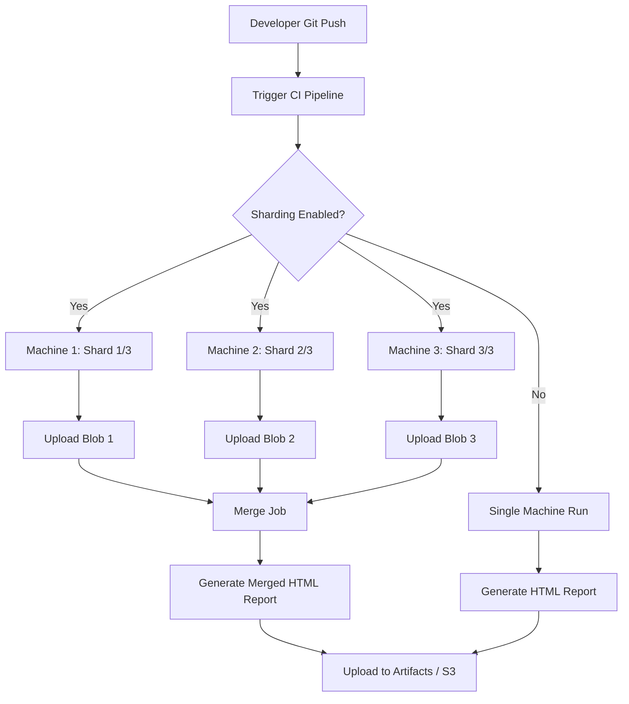

# Framework Architecture: CI/CD Integration

### 1. 🚀 Tutorial Overview
Running tests locally proves your code works on your machine. Running tests in Continuous Integration (CI) proves it works in the real world and prevents regressions from being merged. Playwright is designed to be cloud-native.
Within the automation lifecycle, integrating with CI/CD transforms automation from an isolated activity into a gated quality control process for the entire engineering organization.
**Prerequisites:** Understanding of YAML, GitHub Actions (or Jenkins/GitLab CI), and Docker containers.

### 2. 📌 Core Theoretical Pillars
- **Headless Execution:** In CI, tests run without a GUI (headless mode) using virtual framebuffers (Xvfb on Linux). This is vastly faster and consumes fewer resources.
- **The Playwright Docker Image:** Playwright provides official Docker images (`mcr.microsoft.com/playwright:v1.X.X-jammy`) containing all necessary OS dependencies, browsers, and node versions. Using this guarantees consistency.
- **Sharding:** Splitting a test suite of 1,000 tests across 10 machines, each running 100 tests simultaneously, reducing execution time from 1 hour to 6 minutes.
- **Artifact Management:** CI pipelines are ephemeral. When a container dies, data is lost. You must explicitly instruct the pipeline to upload traces, screenshots, and HTML reports as "Artifacts" so you can view them later.

### 3. 🛠️ Step-by-Step Chronological Implementation

#### Phase 1: The Foundations (Entry Level)

**1. Basic GitHub Actions Workflow**
A standard pipeline that installs dependencies, browsers, and runs tests.

*.github/workflows/playwright.yml*
```yaml
name: Playwright Tests
on:
  push:
    branches: [ main, master ]
  pull_request:
    branches: [ main, master ]

jobs:
  test:
    timeout-minutes: 60
    runs-on: ubuntu-latest
    steps:
    - uses: actions/checkout@v4
    
    - uses: actions/setup-node@v4
      with:
        node-version: lts/*
        
    - name: Install dependencies
      run: npm ci
      
    - name: Install Playwright Browsers
      run: npx playwright install --with-deps
      
    - name: Run Playwright tests
      run: npx playwright test
      
    - name: Upload HTML report
      uses: actions/upload-artifact@v4
      if: always() # Upload even if tests fail!
      with:
        name: playwright-report
        path: playwright-report/
        retention-days: 30
```

#### Phase 2: Intermediate Configurations

**1. Using the Official Docker Container**
Instead of installing browsers on the runner, run directly inside the Playwright image.

```yaml
jobs:
  test:
    runs-on: ubuntu-latest
    # Run all steps inside this container
    container:
      image: mcr.microsoft.com/playwright:v1.40.0-jammy
    steps:
    - uses: actions/checkout@v4
    - run: npm ci
    # Note: No need to run 'playwright install', browsers are already in the image!
    - run: npx playwright test
```

#### Phase 3: Professional Optimization (Senior Level)

**1. Test Sharding (Massive Parallelism)**
Distribute the test suite across a matrix of multiple machines.

```yaml
jobs:
  test:
    runs-on: ubuntu-latest
    strategy:
      fail-fast: false
      matrix:
        shardIndex: [1, 2, 3, 4] # Spin up 4 separate machines
        shardTotal: [4]
    
    steps:
    - uses: actions/checkout@v4
    - uses: actions/setup-node@v4
    - run: npm ci
    - run: npx playwright install --with-deps
    
    - name: Run Shard ${{ matrix.shardIndex }} of ${{ matrix.shardTotal }}
      run: npx playwright test --shard=${{ matrix.shardIndex }}/${{ matrix.shardTotal }}
      
    - name: Upload blob report
      uses: actions/upload-artifact@v4
      if: always()
      with:
        name: blob-report-${{ matrix.shardIndex }}
        path: blob-report/

  merge-reports:
    # Wait for all shards to finish
    needs: [test]
    runs-on: ubuntu-latest
    steps:
    - uses: actions/checkout@v4
    - uses: actions/setup-node@v4
    - run: npm ci
    
    - name: Download all blob reports
      uses: actions/download-artifact@v4
      with:
        path: all-blob-reports
        pattern: blob-report-*
        merge-multiple: true
        
    - name: Merge into HTML Report
      run: npx playwright merge-reports --reporter html ./all-blob-reports
      
    - name: Upload merged report
      uses: actions/upload-artifact@v4
      with:
        name: merged-playwright-report
        path: playwright-report/
```

### 4. 📊 Technical Component Encyclopedia

| Command / Term | Ecosystem | Description |
| :--- | :--- | :--- |
| **`npx playwright install --with-deps`** | CLI | Installs browsers AND required OS-level libraries (fonts, media codecs). |
| **`--shard=1/4`** | CLI | Tells the runner: "Calculate the total tests, split into 4 buckets, run bucket 1." |
| **`--reporter=blob`** | CLI | A special reporter that outputs raw binary data, specifically designed to be merged later after sharding. |
| **`playwright merge-reports`** | CLI | Tool to combine multiple blob reports into a single HTML/JSON report. |
| **`if: always()`** | GitHub Actions | Ensures the step runs even if the previous step (the test run) failed. Critical for saving failure traces. |
| **`container: image:`** | CI Config | Instructs the CI runner to execute the job inside a specific Docker container. |

### 5. 🔄 Visual Workflow (Mermaid)



### 6. 🏭 Real-World Industrial Patterns

**Starting a Local Web Server in CI**
Often, you need Playwright to boot the frontend application (React/Angular) before testing it. You should use the built-in `webServer` config rather than bash scripts.

*playwright.config.ts*
```typescript
export default defineConfig({
  webServer: {
    // The command to start your app
    command: 'npm run start', 
    // Playwright waits until this URL returns a 200 before starting tests
    url: 'http://localhost:3000', 
    // If the server is already running (e.g. locally), reuse it
    reuseExistingServer: !process.env.CI, 
    // Give it plenty of time to boot in CI
    timeout: 120 * 1000, 
  },
});
```
This guarantees that Playwright manages the lifecycle of the web server, tearing it down automatically when tests complete, preventing dangling processes and port-in-use errors on CI runners.
