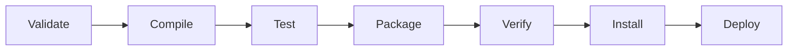

## Maven - The Industry Standard Build Tool

### 1. ⚡ Flashcard Summary (30-Second Review)

- **Status:** A declarative project management and comprehension tool based on the Project Object Model (POM).
- **Why it matters:** Eliminates "Lib Folder" dependencies and standardizes the build lifecycle across enterprise teams.
- **Key Keywords:** POM, Transitive Dependencies, GAV (Group, Artifact, Version), Lifecycle Phases, Goal.

### 2. 🏛️ Architectural Context (The "Why")

- **Convention over Configuration:** Maven enforces a standard directory structure (`src/main/java`, etc.), which reduces the setup time for new projects and makes switching between projects seamless.
- **Dependency Resolution:** Solves the "Dependency Hell" by automatically downloading and managing transitive dependencies (libraries your libraries need).
- **Problem vs. Solution:**
    - *Problem:* Manual JAR management is error-prone, hard to version, and bloats the repository.
    - *Solution:* Maven uses a single `pom.xml` to fetch exact versions from central repositories (Nexus/Artifactory) on-demand.

### 3. 🛠️ Implementation & Mermaid Workflow (The "How")

**The Maven Lifecycle Flow:**



**Clean Maven Directory Structure:**

```text
project-root/
├── src/
│   ├── main/java        (POJOs, API Clients)
│   └── test/java        (TestNG Scripts, Assertions)
├── pom.xml              (The Source of Truth)
└── mvnw                 (The Wrapper - CRITICAL for CI/CD)
```

**Essential Plugin for SDET Frameworks:**

```xml
<plugin>
    <groupId>org.apache.maven.plugins</groupId>
    <artifactId>maven-surefire-plugin</artifactId>
    <version>3.2.5</version>
    <configuration>
        <parallel>methods</parallel>
        <threadCount>5</threadCount>
    </configuration>
</plugin>
```

### 4. ⚖️ The Comparison Matrix (Maven vs. Gradle)

| Feature | Maven | Gradle |
| :--- | :--- | :--- |
| **Philosophy** | Convention over Configuration (Strict) | Configuration over Convention (Flexible) |
| **Language** | Static XML | Dynamic Groovy/Kotlin DSL |
| **Performance** | Slower (Full rebuilds often) | Faster (Incremental builds & Daemon) |
| **Industry Usage** | Standard for Legacy & Enterprise SDET | Growing for Android & High-Speed Microservices |
| **Complexity** | Low (Very predictable) | High (Requires scripting knowledge) |

### 5. 🎤 The "Senior Ace" Q&A

- **Q:** *"What is the difference between a Maven Phase and a Maven Goal?"*
- **A:** "A **Phase** is a stage in the build lifecycle (like `test` or `install`). A **Goal** is a specific task bound to that phase (like `surefire:test`). When you run a phase, all preceding phases in the lifecycle also execute. This predictability is why Maven is so stable for CI/CD pipelines compared to script-based build tools."

### 6. ⚠️ The Gotcha (Production Battle Scars)

- **Dependency Convergence:** Two libraries pulling different versions of the same JAR. 
    - *Fix:* Use `<exclusions>` or the `maven-enforcer-plugin` to force a specific version.
- **SNAPSHOT Volatility:** Using `1.0-SNAPSHOT` in production leads to non-reproducible builds.
    - *Senior Tip:* Always use **Fixed Versions** for releases to ensure the "Build Fingerprint" remains identical across environments.
- **The Wrapper Gap:** Beginners rely on "Installed Maven" on the machine. 
    - *Senior Tip:* Always use the **Maven Wrapper (`mvnw`)**. It ensures the exact same version of Maven is used by local devs, Jenkins, and GitHub Actions.
