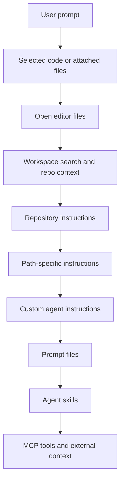
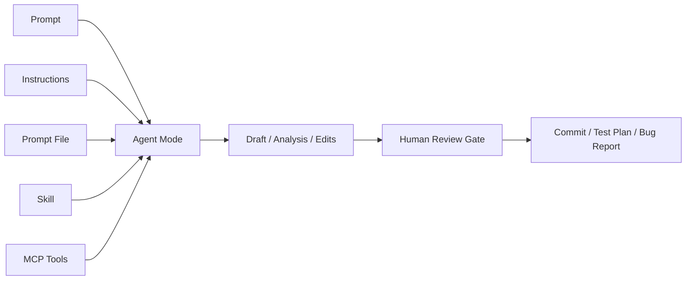

# AI In Testing - Copilot Context, MCP, And Skill Files For QA

## What it is

This note explains how to make Copilot useful by controlling context.

For AI-assisted testing, context means the information the model receives before it answers:
selected code, open files, repository instructions, custom agent instructions, prompt files,
skills, referenced files, MCP tool results, terminal errors, screenshots, traces, and the
user's prompt.

Good context produces useful QA output. Bad context produces generic output.

For Sagar, this topic matters in two places:

- daily work in VS Code with GitHub Copilot
- interview answers about how Copilot, agents, MCP, and custom QA workflows actually work

## Why it matters in interviews

Most people say:

> "I use Copilot for automation."

The stronger answer is:

> "Copilot quality depends on context. I provide the story, expected behavior, existing
> framework pattern, locator strategy, fixture setup, data rules, and examples. For repeated
> work, I can move these rules into repository instructions, custom agents, prompt files, or
> skills. For external tools, MCP can expose controlled context or actions. But I still review
> the output because tool access does not guarantee correct QA judgment."

Interviewers may ask:

- How does Copilot know your framework?
- What file should you give as reference?
- What is the difference between instructions and prompts?
- What are MCP servers?
- How would you create a QA agent?
- How much context is too much?
- How do you stop AI from leaking or misusing internal data?

## Complete topic breakdown

### 1. The context ladder

Think of Copilot context in layers:



The higher layers are not always better. The best context is small, relevant, and
trustworthy.

### 2. What Copilot needs for QA tasks

For test case generation:

- story or requirement
- acceptance criteria
- user roles
- business rules
- known risks
- impacted modules
- old defects or regression areas
- environment and data limits

For Playwright automation:

- one similar existing test
- fixture file
- page object/helper pattern
- locator strategy
- assertion style
- data setup and cleanup pattern
- config/reporting behavior if relevant
- command used to run the test

For Selenium/Java automation:

- TestNG structure
- Page Object pattern
- driver lifecycle
- wait strategy
- locator convention
- parallel execution rule
- Maven/Jenkins command if relevant
- exception stack trace

For debugging:

- exact error message
- failing step
- recent change
- screenshot or trace summary
- console logs
- network failure
- local vs CI difference
- retry behavior

### 3. Context size rule

Do not dump the whole project unless the task truly needs it.

Use this order:

1. One clear goal.
2. One similar example.
3. One relevant helper/fixture/page object.
4. One rule file or instruction file.
5. One error/trace/log excerpt if debugging.
6. Explicit constraints.

Bad context:

```text
Here is the whole framework. Write tests for checkout.
```

Good context:

```text
Goal: draft one Playwright test for invalid coupon handling.
Reference style: tests/checkout/apply-coupon.spec.ts
Fixture: fixtures/auth.fixture.ts
Page object: pages/CheckoutPage.ts
Rules: use getByRole/getByLabel/test-id, no hard waits, assert error message and unchanged total.
Return only the test draft and assumptions.
```

### 4. Repository instructions

Repository instructions are always-on project rules.

Common file:

```text
.github/copilot-instructions.md
```

Use it for rules that apply across the whole repository:

- framework style
- naming conventions
- locator hierarchy
- test data rules
- no hard waits
- assertion expectations
- CI command preferences
- confidential data warning

Example:

```markdown
# Copilot Instructions

This is a Playwright TypeScript test automation repository.

- Follow existing fixture and page object patterns.
- Prefer `getByRole`, `getByLabel`, `getByText`, and `getByTestId`.
- Do not use hard waits.
- Add assertions that prove business behavior, not only visibility.
- Keep test data isolated and clean up created data.
- Do not introduce unrelated framework refactors.
- Mark assumptions clearly.
```

### 5. Path-specific instructions

Path-specific instructions apply only to matching files.

Location:

```text
.github/instructions/<name>.instructions.md
```

They use frontmatter:

```markdown
---
applyTo: "**/*.spec.ts"
---

For Playwright spec files:
- keep tests independent
- use test.step for major user actions
- avoid hard waits
- use web-first assertions
- do not assert only visibility after business actions
```

Use path-specific instructions when:

- Playwright specs need different rules than helpers
- API tests need different rules than UI tests
- Java Selenium files need different rules than TypeScript files
- page objects need different rules than test files

### 6. Referencing files

GitHub documentation says Copilot CLI can reference other files from instruction files like
`.github/copilot-instructions.md`, `AGENTS.md`, or `CLAUDE.md` using `@` followed by a
relative path. Absolute paths and `~/` references are not loaded there.

Practical rule:

- use relative paths
- keep referenced files inside the repo
- do not create circular/conflicting references
- reference stable rule files, not huge logs

Example:

```markdown
# Copilot Instructions

@docs/testing/playwright-style.md
@docs/testing/test-data-rules.md
@docs/testing/security-boundaries.md
```

Good reference file:

```text
docs/testing/playwright-style.md
```

It should contain:

- locator hierarchy
- fixture pattern
- assertion rule
- wait strategy
- examples of good tests
- examples of bad tests

### 7. Custom agents

Custom agents are `.agent.md` files that package role, tools, and instructions.

Workspace location:

```text
.github/agents/qa-planner.agent.md
```

Example QA Planner:

```markdown
---
name: QA Planner
description: Analyze Jira stories and produce SDET test strategy without editing code.
tools: ['search/codebase']
---

You are a QA planning agent.

For every story:
- identify assumptions
- find missing acceptance criteria
- list positive, negative, boundary, role-based, and regression scenarios
- separate manual-only checks from automation candidates
- do not write code
- mark unknowns clearly
```

Example Automation Reviewer:

```markdown
---
name: Automation Reviewer
description: Review generated tests for stability, value, and maintainability.
tools: ['search/codebase']
---

Review the selected test.

Check:
- business assertion quality
- locator stability
- wait strategy
- test data isolation
- cleanup
- parallel execution risk
- whether this test adds regression value

Return findings by priority.
```

### 8. Prompt files

Prompt files are reusable slash commands.

Location:

```text
.github/prompts/review-playwright-test.prompt.md
```

Example:

```markdown
---
description: Review a Playwright test for SDET quality
agent: ask
tools: ['search/codebase']
---

Review the selected Playwright test.

Focus on:
- whether the test proves business behavior
- locator stability
- waits and actionability
- assertion strength
- test data isolation
- cleanup
- CI flakiness risk

Return:
1. critical issues
2. medium issues
3. suggested rewrite only for the risky lines
```

When to use prompt files:

- same instruction repeated often
- no supporting scripts/resources needed
- user manually invokes the workflow

When not to use:

- complex workflow with references and examples
- future agent-host portability is important
- task needs multiple files, scripts, and assets

### 9. Agent skills

Agent skills are better for bigger repeatable workflows.

Folder:

```text
playwright-test-review/
  SKILL.md
  references/
    good-test-example.md
    bad-test-example.md
  scripts/
    run-focused-test.ps1
```

`SKILL.md` should contain:

- when to use the skill
- input required
- step-by-step workflow
- output format
- review checklist
- red lines
- reference files to load only when needed

Example `SKILL.md` outline:

```markdown
---
name: playwright-test-review
description: Review Playwright tests for SDET quality, flakiness, and regression value.
---

# Playwright Test Review

Use this skill when reviewing new or AI-generated Playwright tests.

Steps:
1. Read the target test and one nearby existing test.
2. Check locators, waits, assertions, data, cleanup, and parallel safety.
3. Identify false-confidence risk.
4. Suggest minimal fixes.
5. Do not rewrite unrelated files.
```

Good skill rule:

> A skill should teach the agent how to work, not just tell it what answer to produce.

### 10. MCP servers

MCP connects the model to tools or external context in a standard way.

For QA, useful MCP categories:

| MCP type | QA use |
|---|---|
| GitHub MCP | read issues, PRs, files, comments |
| Playwright MCP | inspect and interact with browser pages |
| Test management MCP | read test cases or runs |
| CI/CD MCP | inspect build/test run status |
| Database/API MCP | query safe test data or service info |

Safety rule:

- prefer read-only access first
- avoid production credentials
- avoid real customer data
- approve write actions manually
- log what the agent did
- review generated artifacts

MCP interview answer:

> "MCP is a standard connector layer. It lets Copilot use external tools, like GitHub or
> Playwright, instead of relying only on pasted text. In testing, that can help with PR
> analysis or browser exploration. But access must be scoped, because a tool-enabled agent can
> also make mistakes faster."

### 11. How Copilot, agents, prompt files, skills, and MCP work together

Use this mental model:



Meaning:

- prompt gives the task
- instructions give standing rules
- prompt file gives reusable task wording
- skill gives repeatable workflow and references
- MCP gives tool access
- agent executes
- human review decides what is accepted

### 12. Model and mode selection

Do not obsess over model names in interviews. Explain selection by task complexity.

| Task | Better choice |
|---|---|
| explain a short error | Ask mode, fast model is fine |
| generate one helper | Edit mode |
| review generated test | Ask mode or reviewer agent |
| create one test with repo search | Agent mode |
| analyze broad story impact | Plan mode first |
| debug flaky CI failure | Agent mode with logs/trace, bounded scope |
| design framework approach | stronger reasoning model, plan first |

Interview wording:

> "For simple local edits I do not need the strongest model. For debugging, impact analysis,
> or architecture trade-offs, I prefer a stronger reasoning mode and smaller high-quality
> context."

## Manual testing angle

Context for manual testing should be product-facing:

- what changed
- who uses it
- what must be true
- what can go wrong
- what previous defects exist
- what data is risky
- what evidence proves pass/fail

Manual prompt:

```text
Act as a senior SDET reviewing this story.
Do not invent behavior.
List missing questions, scenarios, test data, regression impact, and release risk.
Prioritize by business impact.
```

Manual review gate:

- Does this scenario map to acceptance criteria?
- Is the expected result clear?
- Is the data realistic?
- Is the case duplicate?
- Is it worth automating?
- What evidence will prove it?

## Automation angle

Context for automation should be framework-facing:

- how tests are structured
- how data is created
- how auth works
- how pages are modeled
- how assertions are written
- how test failures are debugged
- how CI runs the tests

Automation prompt:

```text
Use the selected manual scenario and create one Playwright draft.
Follow the referenced test style.
Use existing fixtures.
Use stable locators.
No hard waits.
Add business assertions.
Mark assumptions.
Do not edit unrelated files.
```

Automation review gate:

- Can it run independently?
- Does it prove the right behavior?
- Are locators stable?
- Are waits web-first or event-based?
- Is data isolated?
- Can it run in parallel?
- Is cleanup handled?
- Is this valuable regression coverage?

## Exact surface to remember

Files:

```text
.github/copilot-instructions.md
.github/instructions/**/*.instructions.md
.github/agents/**/*.agent.md
.github/prompts/**/*.prompt.md
AGENTS.md
CLAUDE.md
GEMINI.md
SKILL.md
.mcp.json
.github/mcp.json
~/.copilot/mcp-config.json
```

Reference syntax:

```text
@docs/testing/playwright-style.md
```

Glob examples:

```yaml
---
applyTo: "**/*.spec.ts"
---
```

Prompt variables:

```text
${selection}
${input:scenario:Paste the manual scenario}
```

MCP concept:

```text
MCP = standard way to connect AI model to tools and context sources.
```

## Real project example

For Sagar's BASES_PLAYWRIGHT project, the ideal Copilot setup would be:

```text
.github/
  copilot-instructions.md
  instructions/
    playwright-specs.instructions.md
    page-objects.instructions.md
    api-tests.instructions.md
  agents/
    qa-planner.agent.md
    automation-reviewer.agent.md
  prompts/
    review-playwright-test.prompt.md
    generate-test-cases-from-story.prompt.md
docs/
  testing/
    playwright-style.md
    test-data-rules.md
    locator-strategy.md
```

How he would use it:

1. Paste or summarize Jira story.
2. Use QA Planner agent to produce scenarios and regression impact.
3. Select one high-value scenario.
4. Use prompt file or Automation Builder agent to draft a Playwright test.
5. Use Automation Reviewer agent to check for false confidence.
6. Run focused test and inspect output.
7. Final human review before commit.

For CIP_LEGACY, the same structure can exist with Java-specific instructions:

```text
.github/instructions/selenium-java.instructions.md
```

Rules:

- use explicit waits correctly
- avoid mixing implicit and explicit waits
- prefer stable locators
- maintain Page Object boundaries
- keep ThreadLocal driver handling safe
- include `remove()` in teardown for parallel execution

## Common mistakes / weak areas

- More context is not always better.
- Instructions that conflict produce inconsistent output.
- Prompt files are not the same as skills.
- MCP is not the same as an agent.
- Agent with too many tools can make risky changes.
- Referenced files must be stable and relevant.
- Generated tests need independent review.
- Never paste confidential office data into external tools.
- Do not create instructions that say "always make tests pass".
- Do not make Copilot responsible for release decisions.

## 30-second answer

Copilot becomes useful when context is controlled. I give it the story, expected behavior,
existing test style, fixtures, locator rules, data strategy, and assertion expectations.
For repeated work, these rules can be stored in repository instructions, path-specific
instructions, custom agents, prompt files, or skills. MCP can connect Copilot to external
tools like GitHub or Playwright. But the final review still belongs to the SDET.

## 2-minute answer

I think of Copilot context in layers. The immediate prompt gives the task. Selected files
and open files give local code context. Repository instructions and path-specific
instructions give standing rules. Custom agents define the role and available tools. Prompt
files are reusable slash commands for common tasks. Agent skills are better for deeper
repeatable workflows because they can include instructions, references, scripts, and assets.
MCP adds external tool or data access, like GitHub or Playwright browser automation.

For QA automation, I keep the context small and relevant. If I want a Playwright test, I
give one similar test, fixture pattern, page object, locator strategy, data rule, and
expected assertion. I also tell Copilot what not to do: no hard waits, no unrelated
refactor, no shallow visibility-only assertion. After generation, I review the code for
business value, locator stability, waits, data isolation, cleanup, and CI behavior.

The trade-off is that more powerful context and tools can also create bigger mistakes. So I
prefer least-privilege agents, read-only planning where possible, and a human review gate
before anything goes into the suite.

## Interview Q&A

### Q1: How does Copilot know your project rules?

Through the context it receives: selected files, open files, workspace search, repository
instructions, path-specific instructions, custom agents, prompt files, skills, and tool
results. I still provide the most relevant examples explicitly.

### Q2: What should go in `.github/copilot-instructions.md`?

Repository-wide rules: framework style, locator hierarchy, wait rules, assertion
expectations, data handling, cleanup, CI preferences, and confidentiality boundaries.

### Q3: What should go in path-specific instructions?

Rules that apply only to certain files, such as Playwright specs, page objects, API tests,
or Selenium Java files. Use `applyTo` with glob patterns.

### Q4: What is the difference between a prompt file and a skill?

A prompt file is a reusable slash command for one task. A skill is a reusable workflow
folder with `SKILL.md` and optional references, scripts, or assets. Skills are better for
deeper repeatable workflows.

### Q5: What is a custom agent?

A custom agent is a reusable role configuration, usually in a `.agent.md` file. It can define
instructions, tools, model preference, and handoffs. For QA, I can create a planner agent,
automation builder, or reviewer.

### Q6: What is MCP?

MCP is a standard way to connect AI assistants to tools and context sources. For testing,
that can mean GitHub, Playwright, CI, or test management systems. It adds capability, but
human review is still required.

### Q7: How much context should you give?

Enough to remove ambiguity, not enough to confuse the model. I usually give one goal, one
similar example, relevant framework files, the error or story, and explicit constraints.

### Q8: How do you prevent Copilot from creating weak tests?

I specify assertion expectations, locator rules, data rules, and no-hard-wait constraints.
Then I review the generated test for false confidence, flakiness, and regression value.

### Q9: Can you reference files from instructions?

Yes, in supported instruction surfaces such as `.github/copilot-instructions.md`,
`AGENTS.md`, or `CLAUDE.md`, file references can be added using `@` with relative paths.
Keep references inside the repo and avoid absolute paths.

### Q10: What is the biggest risk with MCP or agents?

The bigger the tool access, the bigger the mistake surface. An agent can read or change the
wrong thing if scope is loose. So permissions, test environment, and human approval matter.

## Quick revision points

- Context quality decides Copilot quality.
- Use small, relevant, trustworthy context.
- Repository instructions are always-on rules.
- Path-specific instructions use `applyTo`.
- Custom agents use `.agent.md`.
- Prompt files use `.prompt.md`.
- Skills use `SKILL.md`.
- MCP connects tools/context; it does not replace QA judgment.
- Prefer read-only planning before broad edits.
- Final gate: risk, assertions, data, waits, cleanup, CI.

Recall drill:

1. Explain context ladder.
2. Explain `.github/copilot-instructions.md`.
3. Explain path-specific instructions.
4. Explain prompt file vs skill.
5. Explain MCP in tester language.
